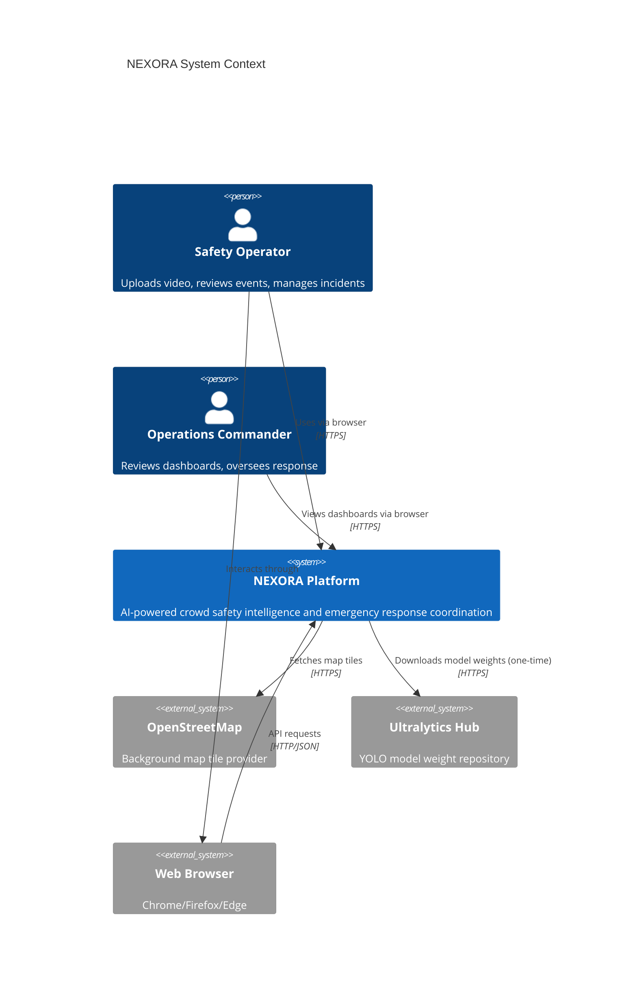
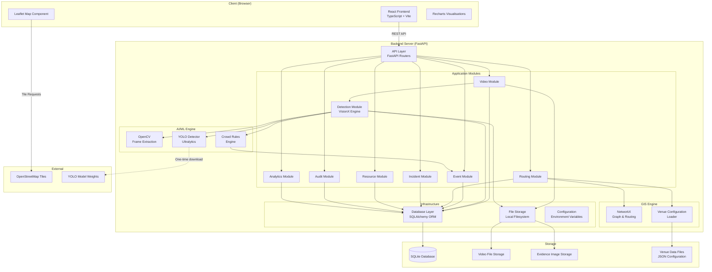
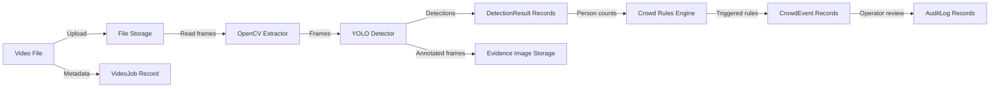
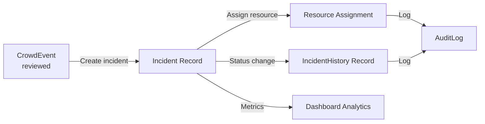
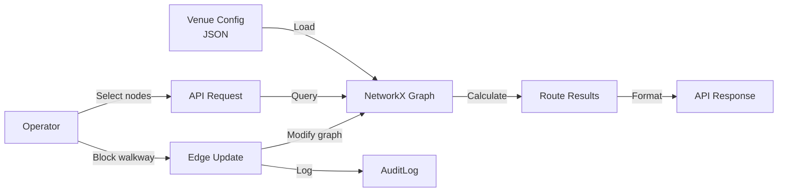
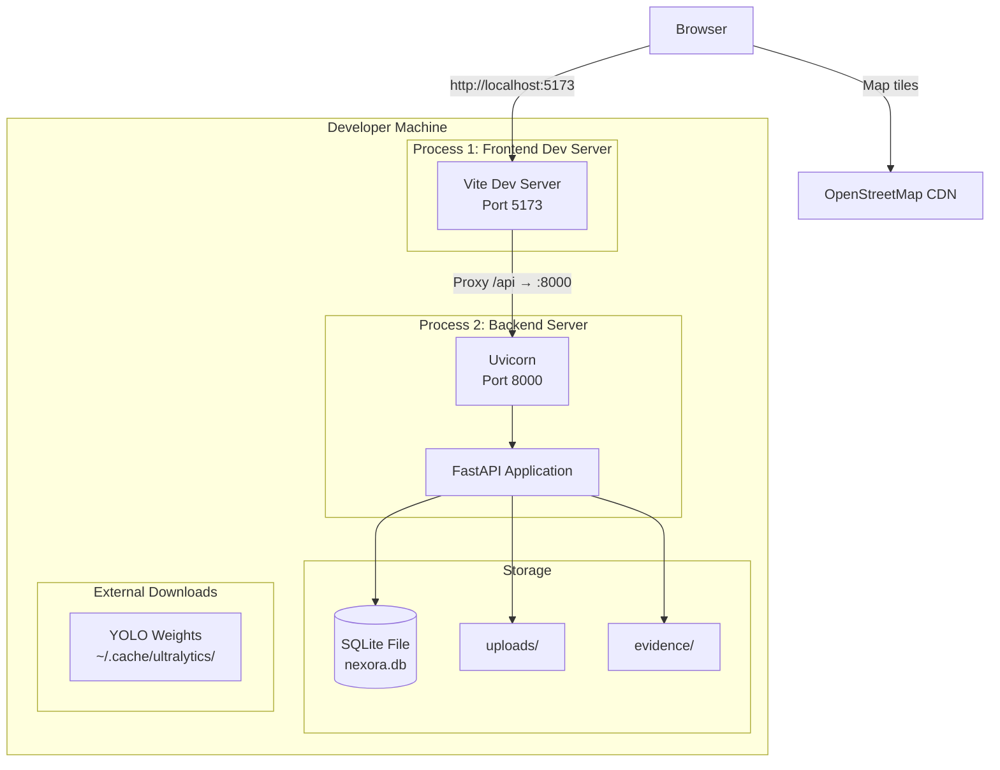
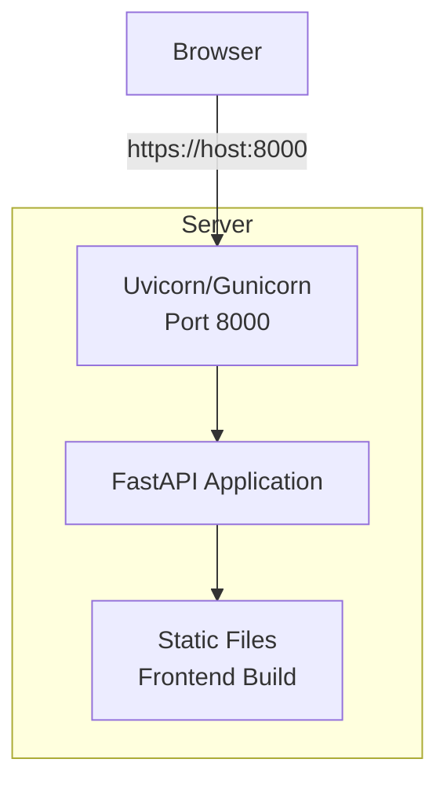
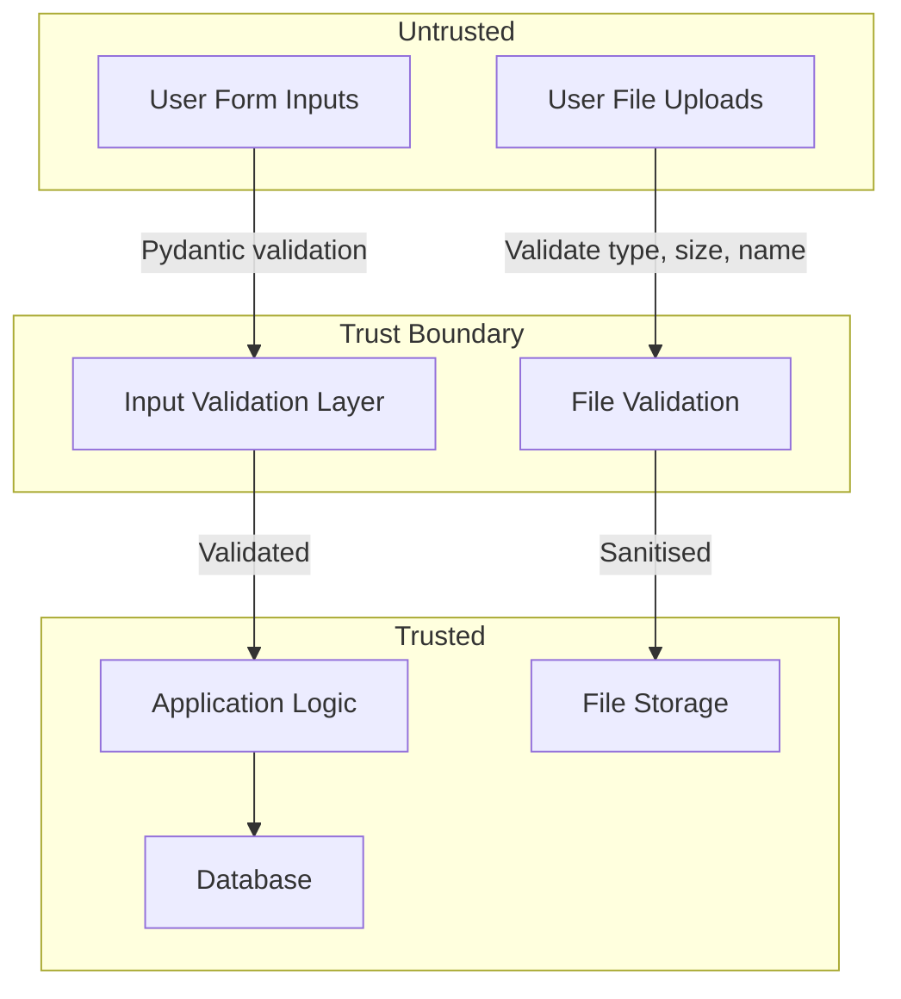

# NEXORA — System Architecture

**Document ID:** DOC-006  
**Version:** 1.0  
**Status:** Draft  
**Created:** 2026-10-09  
**Last Updated:** 2026-10-09  

---

## 1. System Context Diagram



## 2. High-Level Component Diagram



## 3. Module Responsibilities

### 3.1 Frontend (React + TypeScript)

| Responsibility | Description |
|---------------|-------------|
| UI rendering | React components with design system |
| State management | React context/state for UI state; server state via API calls |
| Routing | React Router for page navigation |
| Map rendering | Leaflet integration for GIS display |
| Chart rendering | Recharts for data visualisation |
| API communication | Fetch/Axios for REST API calls |
| File upload | File selection and upload handling |
| Form validation | Client-side validation before submission |

**Not responsible for:** AI processing, route calculation, data persistence, business rule evaluation.

### 3.2 Backend — API Layer (FastAPI)

| Responsibility | Description |
|---------------|-------------|
| Request routing | HTTP method + path → handler function |
| Request validation | Pydantic model validation |
| Response serialisation | JSON response formatting |
| Error handling | Consistent error response format |
| CORS management | Cross-origin request configuration |
| Static file serving | Evidence images and (optionally) frontend build |

### 3.3 Backend — Video Module

| Responsibility | Description |
|---------------|-------------|
| Upload handling | Receive, validate, and store video files |
| Job management | Create, track, and update processing jobs |
| Background processing | Initiate and manage background tasks |
| File cleanup | Remove orphaned files on deletion |

### 3.4 Backend — Detection Module (VisionX Engine)

| Responsibility | Description |
|---------------|-------------|
| Frame extraction | OpenCV-based sampling from video |
| Object detection | YOLO inference on extracted frames |
| Class filtering | Person-class isolation from detections |
| Confidence filtering | Threshold-based detection filtering |
| Evidence generation | Annotated image creation with bounding boxes |
| Result storage | Persist detection records to database |

### 3.5 Backend — Event Module

| Responsibility | Description |
|---------------|-------------|
| Rule evaluation | Apply crowd-count rules to detection results |
| Event creation | Generate events from triggered rules |
| Event review | Process operator review actions |
| Status management | Track event state transitions |

### 3.6 Backend — Routing Module (GIS Engine)

| Responsibility | Description |
|---------------|-------------|
| Venue data management | Load and serve venue configuration |
| Graph management | Maintain NetworkX graph of venue |
| Route calculation | Shortest path and alternative routes |
| Edge management | Block/reopen walkways |
| Cost calculation | Apply cost formula to routes |

### 3.7 Backend — Incident Module

| Responsibility | Description |
|---------------|-------------|
| Incident CRUD | Create, read, update incidents |
| Status transitions | Validate and apply state machine |
| Resource assignment | Link resources to incidents |
| History tracking | Record all incident changes |

### 3.8 Backend — Resource Module

| Responsibility | Description |
|---------------|-------------|
| Resource listing | Retrieve available resources |
| Status tracking | Manage resource availability |
| Assignment validation | Prevent double-assignment |

### 3.9 Backend — Audit Module

| Responsibility | Description |
|---------------|-------------|
| Action logging | Record all operator actions |
| Log retrieval | Query and filter audit entries |
| Entity linking | Associate logs with target entities |

### 3.10 Backend — Analytics Module

| Responsibility | Description |
|---------------|-------------|
| Metric calculation | Aggregate metrics from database |
| Chart data preparation | Format data for frontend charts |
| Dashboard data | Compute dashboard summary values |

## 4. Data Flow

### 4.1 Video-to-Event Data Flow



### 4.2 Event-to-Incident Data Flow



### 4.3 Route Calculation Data Flow



## 5. Deployment Architecture

### 5.1 Local Development (Primary Target)



### 5.2 Production Build (Optional)



In production mode, the FastAPI server serves the built frontend assets as static files, eliminating the need for a separate frontend server.

## 6. External Dependencies

| Dependency | Purpose | Availability Risk | Mitigation |
|-----------|---------|------------------|------------|
| OpenStreetMap tiles | Map background | Low (highly available) | Functional without tiles (venue overlay still works) |
| YOLO model weights | Person detection | Low (cached after first download) | Pre-download during setup; cache locally |
| npm registry | Frontend packages | Low | lock file ensures reproducibility |
| PyPI | Python packages | Low | requirements.txt ensures reproducibility |

## 7. Trust Boundaries



**Trust boundary rules:**
1. All user input crosses a trust boundary and must be validated.
2. Uploaded files are treated as untrusted binary data.
3. Database queries use parameterised statements (via SQLAlchemy).
4. File paths are constructed server-side, never from user input.
5. Error messages crossing the trust boundary outward are sanitised.

## 8. Failure Modes

| Failure | Impact | Detection | Recovery |
|---------|--------|-----------|----------|
| Video file corrupt | Processing job fails | OpenCV exception | Mark job failed, notify operator |
| YOLO model missing | Cannot process video | Model load exception | Error message, download instructions |
| SQLite locked | Write operations fail | Database exception | Retry with backoff (WAL mode mitigates) |
| Map tiles unavailable | No map background | Tile load error | Venue overlay renders without background |
| Disk full | Cannot save files | OS exception | Error message, cleanup suggestion |
| Background task crash | Job stuck in "processing" | Timeout detection | Periodic stale job check, mark failed |
| Invalid venue config | Routing errors | Config validation | Fallback to empty venue, error notification |
| Out of memory (YOLO) | Process crash | OS kill signal | Smaller model suggestion, frame skip |

## 9. Architecture Decisions

### Decision 1: Modular Monolith

**Context:** The application has multiple functional areas (video, detection, events, routing, incidents) that need to share data.

**Decision:** Use a modular monolith architecture — a single FastAPI application with well-defined module boundaries.

**Rationale:**
- Simplicity for hackathon prototype
- Shared database access without network overhead
- Easier debugging and deployment
- Modules can be extracted later if needed

**Rejected alternatives:** Microservices (excessive complexity), serverless (insufficient for video processing).

See ADR-002 for full record.

### Decision 2: Background Processing via Threading

**Context:** Video processing is CPU-intensive and must not block the API.

**Decision:** Use Python `concurrent.futures.ThreadPoolExecutor` or `BackgroundTasks` in FastAPI for video processing jobs.

**Rationale:**
- Simple to implement
- No external message broker needed
- Sufficient for single-user prototype
- Job status tracked in database

**Rejected alternatives:** Celery + Redis (over-engineered for prototype), multiprocessing (complex for shared state).

**Trade-off:** Limited to one concurrent processing job due to CPU constraints. GIL may limit true parallelism, but YOLO/OpenCV release the GIL for compute-heavy operations.

### Decision 3: File-Based Media Storage

**Context:** Uploaded videos and evidence images need persistent storage.

**Decision:** Store media files on the local filesystem with paths referenced in the database.

**Rationale:**
- Simple and performant for local development
- No blob storage service needed
- Files organised by job ID for easy cleanup

**Rejected alternatives:** Database BLOBs (performance issues), S3 (requires cloud account).

### Decision 4: Venue Graph as Configuration

**Context:** Route calculation needs an explicit venue walkway network.

**Decision:** Define the venue graph in JSON configuration files loaded at startup.

**Rationale:**
- Separates venue data from application code
- Easy to swap demo venues
- Deterministic for testing
- Clear boundary between OSM (visual tiles) and routing data

## 10. Modularity Without Microservices

The backend is structured as a single application with internal module boundaries:

```
backend/
├── app/
│   ├── main.py              # FastAPI application entry point
│   ├── config.py             # Environment configuration
│   ├── database.py           # SQLAlchemy setup
│   ├── models/               # SQLAlchemy ORM models
│   ├── schemas/              # Pydantic request/response schemas
│   ├── routers/              # FastAPI route handlers
│   │   ├── videos.py
│   │   ├── events.py
│   │   ├── venue.py
│   │   ├── routes.py
│   │   ├── incidents.py
│   │   ├── resources.py
│   │   ├── audit.py
│   │   └── analytics.py
│   ├── services/             # Business logic
│   │   ├── video_service.py
│   │   ├── detection_service.py
│   │   ├── event_service.py
│   │   ├── routing_service.py
│   │   ├── incident_service.py
│   │   └── audit_service.py
│   └── visionx/              # AI/CV engine
│       ├── frame_extractor.py
│       ├── detector.py
│       └── crowd_rules.py
```

**Module interaction rules:**
- Routers depend on services (never on other routers)
- Services may depend on other services for cross-module operations
- All modules share the same database session factory
- VisionX is isolated and could be extracted to a separate process

---

*End of Document 06 — System Architecture*
