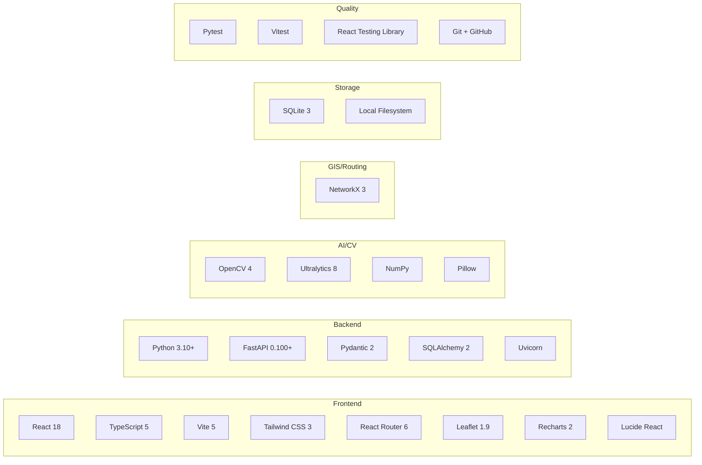

# NEXORA — Technical Design and Technology Decisions

**Document ID:** DOC-007  
**Version:** 1.0  
**Status:** Draft  
**Created:** 2026-10-09  
**Last Updated:** 2026-10-09  

---

## 1. Technology Stack Overview



## 2. Frontend Technologies

### 2.1 React 18

**Why needed:** Component-based UI framework for building the interactive command-centre interface.

**Key reasons:**
- Large ecosystem and community support.
- Hooks-based architecture for state management without class components.
- Concurrent features (Suspense, transitions) for smooth UX during data loading.
- Extensive testing tooling (React Testing Library, Vitest).

**Alternatives considered:**
- **Vue 3:** Comparable capability but smaller hackathon-relevant ecosystem for map and chart integrations.
- **Svelte:** Excellent performance but fewer mature libraries for Leaflet integration.
- **Vanilla JS:** Possible but significantly slower to develop complex UI.

**Dependencies:** `react`, `react-dom`

### 2.2 TypeScript 5

**Why needed:** Type safety for a multi-module frontend reduces bugs and improves developer experience.

**Key reasons:**
- Catches API contract mismatches at compile time.
- IntelliSense for faster development.
- Self-documenting type definitions for Pydantic-equivalent schemas.

**Limitation:** Adds build complexity. Justified by the scale of the application.

**Dependencies:** `typescript`, `@types/react`, `@types/react-dom`

### 2.3 Vite 5

**Why needed:** Fast build tool and development server for React + TypeScript.

**Key reasons:**
- Near-instant hot module replacement (HMR).
- Native ES module support — no bundling during development.
- Simple configuration.
- Built-in proxy support for API calls to backend.

**Alternative considered:** Create React App (CRA) — deprecated, slower builds.

**Configuration note:** Vite proxy will be configured to forward `/api/*` requests to the FastAPI backend at `localhost:8000`.

### 2.4 Tailwind CSS 3

**Why needed:** Utility-first CSS framework for rapid, consistent styling.

**Key reasons:**
- Design system tokens map naturally to Tailwind's configuration.
- Consistent spacing, colours, and typography without writing custom CSS classes for each component.
- Responsive utilities built-in.
- Small production bundle via purging.

**Alternative considered:** Vanilla CSS (more control but significantly slower development). Shadcn/ui (adds component library dependency).

**Note:** Custom design tokens from the UI/UX spec will be configured in `tailwind.config.js` to ensure the design system is respected.

### 2.5 React Router 6

**Why needed:** Client-side routing for SPA navigation between screens.

**Key reasons:**
- Standard routing library for React.
- Data loaders and actions for route-level data fetching.
- Nested routes for layout composition (sidebar + content).
- URL-based state for deep linking to events/incidents.

### 2.6 Leaflet 1.9

**Why needed:** Interactive map rendering for the GIS Operations module.

**Key reasons:**
- Open-source with permissive licence (BSD-2-Clause).
- Lightweight (~40KB gzipped).
- Extensive plugin ecosystem.
- Works with OpenStreetMap tiles (no API key required for basic usage).
- `react-leaflet` provides React bindings.

**Alternative considered:** Mapbox GL JS (requires API key, better performance for dense data), OpenLayers (more powerful but heavier).

**Dependencies:** `leaflet`, `react-leaflet`, `@types/leaflet`

### 2.7 Recharts 2

**Why needed:** Data visualisation for detection timelines, incident charts, and dashboard metrics.

**Key reasons:**
- React-native composable chart API.
- Supports area, line, bar, donut/pie charts needed by the design.
- Responsive and animated.
- Declarative API matches React patterns.

**Alternative considered:** Chart.js + react-chartjs-2 (imperative API), D3 (too low-level for this scope).

### 2.8 Lucide React

**Why needed:** Consistent icon library for the command-centre UI.

**Key reasons:**
- Open-source, MIT licence.
- Comprehensive icon set (1000+ icons) including relevant ones (shield, map, alert, etc.).
- Tree-shakeable — only imported icons are bundled.
- SVG-based for crisp rendering at all sizes.

**Alternative considered:** Heroicons (fewer icons), FontAwesome (heavier).

## 3. Backend Technologies

### 3.1 Python 3.10+

**Why needed:** Primary backend language, required for OpenCV and YOLO integration.

**Key reasons:**
- Dominant language for AI/ML libraries (OpenCV, Ultralytics, NumPy).
- Rich ecosystem for web frameworks (FastAPI) and graph analysis (NetworkX).
- f-strings, type hints, match statements (3.10+) for clean code.
- Wide community knowledge for hackathon debugging.

**Minimum version:** 3.10 (for `match` statements and improved type hints). 3.11+ recommended for performance.

### 3.2 FastAPI 0.100+

**Why needed:** High-performance async web framework for the REST API.

**Key reasons:**
- Automatic OpenAPI/Swagger documentation.
- Pydantic integration for request/response validation.
- Async support for non-blocking I/O.
- Background task support (for video processing).
- Dependency injection for clean architecture.
- Excellent performance benchmarks among Python frameworks.

**Alternative considered:** Flask (no async, no built-in validation), Django (too heavy for API-only backend), Express.js (would require two languages).

**Dependencies:** `fastapi`, `uvicorn[standard]`, `python-multipart` (for file uploads)

### 3.3 Pydantic 2

**Why needed:** Data validation and serialisation for API contracts.

**Key reasons:**
- Automatic request validation with descriptive errors.
- Type-safe response models.
- JSON Schema generation.
- V2 is significantly faster than V1.
- Integrates seamlessly with FastAPI.

### 3.4 SQLAlchemy 2

**Why needed:** ORM for database operations with SQLite.

**Key reasons:**
- Mature, well-documented ORM.
- 2.0 style with improved type hints and async support.
- Declarative model definitions.
- Supports SQLite natively.
- Migration support via Alembic (if needed later).

**Note:** Using synchronous SQLAlchemy with SQLite (async SQLite drivers add complexity without benefit for single-user prototype).

### 3.5 Uvicorn

**Why needed:** ASGI server to run FastAPI.

**Key reasons:**
- Recommended server for FastAPI.
- Hot reload for development (`--reload` flag).
- Simple configuration.

## 4. AI/Computer Vision Technologies

### 4.1 OpenCV (opencv-python-headless) 4.x

**Why needed:** Video file reading and frame extraction.

**Key reasons:**
- Industry-standard library for video/image processing.
- `VideoCapture` for frame-by-frame video reading.
- Image manipulation for evidence generation.
- `opencv-python-headless` variant avoids GUI dependencies (no X11/Qt needed on server).

**Dependencies:** `opencv-python-headless`

**Limitation:** Cannot handle all video codecs. H.264 (MP4) is widely supported. Some AVI codecs may fail.

### 4.2 Ultralytics (YOLOv8)

**Why needed:** Pretrained object detection model for person detection.

**Key reasons:**
- Provides pretrained YOLO models with simple Python API.
- YOLOv8n (nano) model suitable for CPU inference.
- Person class (class 0 in COCO) well-supported.
- Handles model weight downloading and caching automatically.
- AGPL-3.0 licence (acceptable for hackathon; commercial use requires licence purchase).

**Model selection:**
| Model | Size | Speed (CPU) | Accuracy | Recommendation |
|-------|------|-------------|----------|---------------|
| YOLOv8n | 6.2 MB | ~45ms/frame | Good | **Default for prototype** |
| YOLOv8s | 21.5 MB | ~100ms/frame | Better | Alternative if accuracy needed |
| YOLOv8m | 49.7 MB | ~200ms/frame | High | Too slow for CPU |

**Dependencies:** `ultralytics`, `torch` (installed as dependency)

**Important:** PyTorch is a large dependency (~500 MB for CPU). This is unavoidable for YOLO but should be noted in setup documentation.

### 4.3 NumPy

**Why needed:** Array operations for image processing and detection result handling.

**Installed as dependency** of OpenCV and Ultralytics. No additional install needed.

### 4.4 Pillow

**Why needed:** Image format conversion and evidence image saving.

**Installed as dependency** of Ultralytics. Used for JPEG/PNG encoding of evidence images.

## 5. GIS and Routing Technologies

### 5.1 NetworkX 3

**Why needed:** Graph-based routing for the venue walkway network.

**Key reasons:**
- Pure Python graph library — no compiled dependencies.
- Built-in shortest path algorithms (Dijkstra, A*).
- Simple API for graph construction and manipulation.
- Supports weighted edges for cost-based routing.
- K-shortest-paths algorithms for route alternatives.

**Alternative considered:** igraph (faster but compiled C dependencies), custom Dijkstra (unnecessary reimplementation).

**Dependencies:** `networkx`

## 6. Storage Technologies

### 6.1 SQLite 3

**Why needed:** Relational database for persisting all application data.

**Key reasons:**
- Zero-configuration — no server process needed.
- Single file — easy to back up, reset, or inspect.
- Built into Python standard library.
- Sufficient for single-user prototype data volumes.
- ACID-compliant transactions.

**Limitations:**
- Single writer at a time (mitigated by WAL mode).
- No network access (local only).
- No stored procedures or advanced features.

**Mitigation:** WAL (Write-Ahead Logging) mode enables concurrent reads during writes. Sufficient for prototype.

**Alternative for later:** PostgreSQL for production multi-user deployment.

### 6.2 Local Filesystem

**Why needed:** Storage for uploaded videos and evidence images.

**Organisation:**
```
data/
├── uploads/          # Uploaded video files
│   └── {job_id}/     # Organised by job
│       └── video.mp4
├── evidence/         # Evidence images
│   └── {job_id}/     # Organised by job
│       └── frame_{n}.jpg
└── venue/            # Venue configuration files
    └── demo_venue.json
```

## 7. Quality and Delivery Technologies

### 7.1 Pytest

**Why needed:** Backend testing framework.

**Key reasons:**
- Standard Python testing framework.
- Fixtures for test setup/teardown.
- Parametrised tests for boundary testing.
- Plugins: `pytest-asyncio` for async tests, `httpx` for API testing.

**Dependencies:** `pytest`, `httpx` (for TestClient)

### 7.2 Vitest + React Testing Library

**Why needed:** Frontend unit and component testing.

**Key reasons:**
- Vitest is native to Vite — fast, compatible configuration.
- React Testing Library tests components from user perspective.
- jsdom for DOM simulation.

### 7.3 Git + GitHub

**Why needed:** Version control and collaboration.

**Strategy:**
- Main branch for stable releases.
- Feature branches for development.
- Conventional commits for clear history.

## 8. Dependency Compatibility Matrix

| Dependency | Python Version | OS Compatibility | Notes |
|-----------|---------------|-----------------|-------|
| FastAPI | ≥3.8 | All | No OS-specific issues |
| SQLAlchemy 2 | ≥3.7 | All | SQLite built-in |
| OpenCV-headless | ≥3.8 | All | Headless avoids GUI deps |
| Ultralytics | ≥3.8 | All | Downloads PyTorch (~500MB) |
| NetworkX | ≥3.9 | All | Pure Python |
| Pydantic 2 | ≥3.8 | All | FastAPI 0.100+ required |

| Dependency | Node Version | Notes |
|-----------|-------------|-------|
| React 18 | ≥16 | No issues |
| Vite 5 | ≥18 | ESM support required |
| Tailwind 3 | ≥16 | PostCSS dependency |
| Leaflet 1.9 | ≥16 | Browser-side rendering |

## 9. Technologies Explicitly Deferred

| Technology | Reason for Deferral |
|-----------|-------------------|
| Redis | No need for caching or message brokering at prototype scale |
| Celery | Background tasks handled by FastAPI BackgroundTasks / ThreadPool |
| Docker | Local development sufficient; containerisation adds setup complexity |
| Kubernetes | Completely unnecessary for prototype |
| PostgreSQL | SQLite sufficient; PostgreSQL adds server setup |
| WebSocket | Polling sufficient for job status updates in prototype |
| JWT/OAuth | Authentication deferred; simulated operator identity |
| S3/Cloud storage | Local filesystem sufficient |
| Nginx | Vite dev server + Uvicorn sufficient for local development |
| CI/CD pipelines | Manual testing sufficient for hackathon |

## 10. Known Limitations

| Limitation | Impact | Mitigation |
|-----------|--------|------------|
| PyTorch size (~500 MB) | Long initial install | Document in setup; use CPU-only PyTorch variant |
| YOLO CPU inference speed | 45ms+ per frame | Configurable frame sampling to reduce total frames |
| SQLite write concurrency | Potential lock during processing | WAL mode; single-user assumption |
| OpenCV codec support | Some video formats may fail | Document supported formats; validate on upload |
| Map tile dependency | Map requires internet | Venue overlay functional without tiles |
| Tailwind purge | Unused styles must be purged for production | Configure content paths in tailwind.config |

## 11. Package Management

### Backend (Python)
```
# requirements.txt
fastapi>=0.100.0
uvicorn[standard]>=0.23.0
sqlalchemy>=2.0.0
pydantic>=2.0.0
python-multipart>=0.0.6
opencv-python-headless>=4.8.0
ultralytics>=8.0.0
networkx>=3.0
python-dotenv>=1.0.0
aiofiles>=23.0.0
```

### Frontend (Node.js)
```
# package.json dependencies
react: ^18.2.0
react-dom: ^18.2.0
react-router-dom: ^6.20.0
recharts: ^2.10.0
leaflet: ^1.9.4
react-leaflet: ^4.2.1
lucide-react: ^0.294.0
axios: ^1.6.0

# devDependencies
typescript: ^5.3.0
@types/react: ^18.2.0
@types/react-dom: ^18.2.0
@types/leaflet: ^1.9.0
@vitejs/plugin-react: ^4.2.0
tailwindcss: ^3.4.0
postcss: ^8.4.0
autoprefixer: ^10.4.0
vite: ^5.0.0
vitest: ^1.0.0
@testing-library/react: ^14.0.0
@testing-library/jest-dom: ^6.0.0
jsdom: ^23.0.0
```

---

*End of Document 07 — Technical Design and Technology Decisions*
