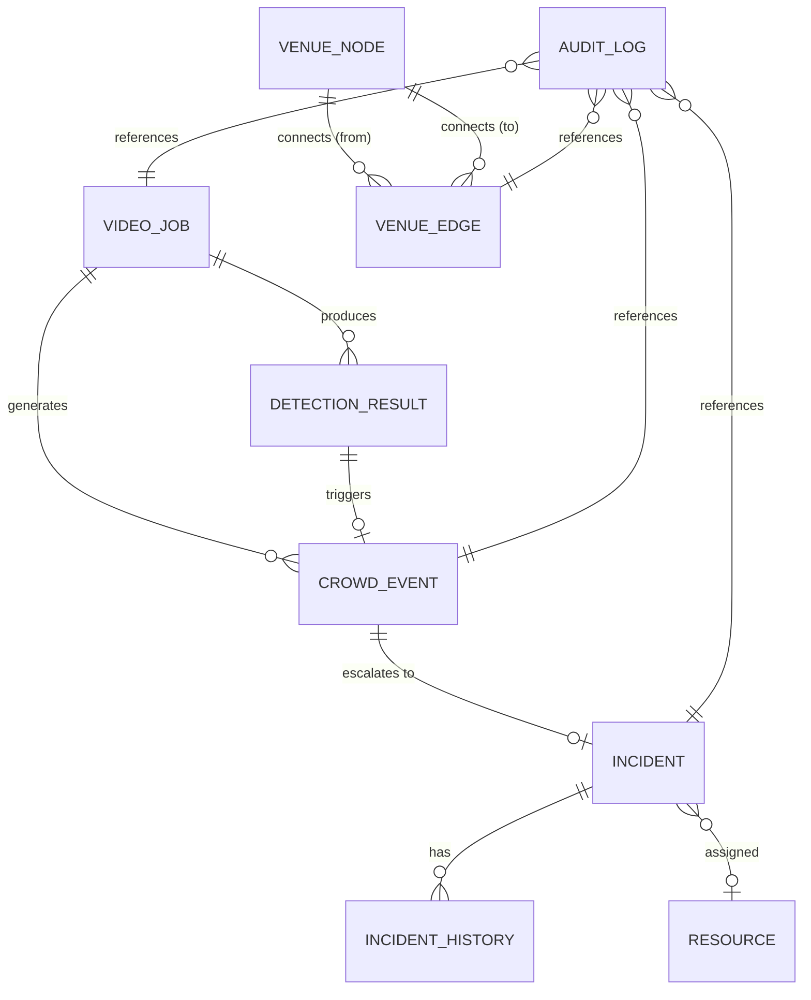

# NEXORA — Database Design

**Document ID:** DOC-008  
**Version:** 1.0  
**Status:** Draft  
**Created:** 2026-10-09  
**Last Updated:** 2026-10-09  

---

## 1. Entity Relationship Diagram



## 2. Table Definitions

### 2.1 video_jobs

Tracks uploaded videos and their processing status.

| Column | Type | Nullable | Unique | Default | Description |
|--------|------|----------|--------|---------|-------------|
| `id` | VARCHAR(36) | No | Yes (PK) | UUID4 | Unique job identifier |
| `original_filename` | VARCHAR(255) | No | No | — | Original uploaded filename (sanitised) |
| `stored_filename` | VARCHAR(255) | No | Yes | — | Server-side stored filename |
| `file_path` | VARCHAR(512) | No | No | — | Relative path to stored video file |
| `file_size_bytes` | BIGINT | No | No | — | File size in bytes |
| `file_type` | VARCHAR(10) | No | No | — | File extension (mp4, avi, mov, mkv) |
| `zone_id` | VARCHAR(50) | Yes | No | NULL | Associated venue zone identifier |
| `status` | VARCHAR(20) | No | No | 'queued' | Job status: queued, processing, completed, failed |
| `sampling_interval_sec` | FLOAT | No | No | 2.0 | Frame extraction interval in seconds |
| `confidence_threshold` | FLOAT | No | No | 0.5 | Minimum detection confidence |
| `model_name` | VARCHAR(50) | No | No | 'yolov8n' | YOLO model used |
| `total_frames_extracted` | INTEGER | Yes | No | NULL | Number of frames processed |
| `total_persons_detected` | INTEGER | Yes | No | NULL | Sum of person detections |
| `max_person_count` | INTEGER | Yes | No | NULL | Maximum count in any single frame |
| `avg_person_count` | FLOAT | Yes | No | NULL | Average count across frames |
| `processing_duration_sec` | FLOAT | Yes | No | NULL | Total processing time |
| `error_message` | TEXT | Yes | No | NULL | Error details if failed |
| `created_at` | DATETIME | No | No | NOW | Job creation timestamp |
| `started_at` | DATETIME | Yes | No | NULL | Processing start timestamp |
| `completed_at` | DATETIME | Yes | No | NULL | Processing completion timestamp |

**Primary Key:** `id`  
**Indexes:** `status`, `zone_id`, `created_at`

### 2.2 detection_results

Per-frame detection data from YOLO processing.

| Column | Type | Nullable | Unique | Default | Description |
|--------|------|----------|--------|---------|-------------|
| `id` | VARCHAR(36) | No | Yes (PK) | UUID4 | Unique detection result identifier |
| `job_id` | VARCHAR(36) | No | No | — | FK → video_jobs.id |
| `frame_index` | INTEGER | No | No | — | Sequential frame number |
| `timestamp_sec` | FLOAT | No | No | — | Time offset in video (seconds) |
| `person_count` | INTEGER | No | No | — | Number of persons detected |
| `avg_confidence` | FLOAT | Yes | No | NULL | Average confidence of detections |
| `min_confidence` | FLOAT | Yes | No | NULL | Minimum confidence |
| `max_confidence` | FLOAT | Yes | No | NULL | Maximum confidence |
| `bounding_boxes_json` | TEXT | Yes | No | NULL | JSON array of bounding boxes: [{x,y,w,h,conf}] |
| `evidence_image_path` | VARCHAR(512) | Yes | No | NULL | Relative path to annotated evidence image |
| `created_at` | DATETIME | No | No | NOW | Record creation timestamp |

**Primary Key:** `id`  
**Foreign Keys:** `job_id` → `video_jobs(id)` ON DELETE CASCADE  
**Indexes:** `job_id`, `(job_id, frame_index)` UNIQUE, `timestamp_sec`

### 2.3 crowd_events

Events generated when crowd-count rules are triggered.

| Column | Type | Nullable | Unique | Default | Description |
|--------|------|----------|--------|---------|-------------|
| `id` | VARCHAR(36) | No | Yes (PK) | UUID4 | Unique event identifier |
| `job_id` | VARCHAR(36) | No | No | — | FK → video_jobs.id |
| `detection_id` | VARCHAR(36) | Yes | No | NULL | FK → detection_results.id (peak frame) |
| `zone_id` | VARCHAR(50) | Yes | No | NULL | Associated venue zone |
| `rule_type` | VARCHAR(30) | No | No | — | Rule that triggered: 'threshold', 'sustained' |
| `person_count` | INTEGER | No | No | — | Person count that triggered the event |
| `threshold_value` | INTEGER | No | No | — | Threshold that was exceeded |
| `sustained_frames` | INTEGER | Yes | No | NULL | Number of consecutive frames (for sustained rule) |
| `severity` | VARCHAR(10) | No | No | 'medium' | Severity: low, medium, high, critical |
| `status` | VARCHAR(20) | No | No | 'pending_review' | Status: pending_review, acknowledged, dismissed, escalated |
| `description` | TEXT | No | No | — | Human-readable event description |
| `evidence_image_path` | VARCHAR(512) | Yes | No | NULL | Path to the peak-frame evidence image |
| `frame_timestamp_sec` | FLOAT | Yes | No | NULL | Video timestamp of the triggering frame |
| `reviewed_by` | VARCHAR(100) | Yes | No | NULL | Operator who reviewed |
| `reviewed_at` | DATETIME | Yes | No | NULL | Review timestamp |
| `review_notes` | TEXT | Yes | No | NULL | Operator notes on review |
| `created_at` | DATETIME | No | No | NOW | Event creation timestamp |

**Primary Key:** `id`  
**Foreign Keys:** `job_id` → `video_jobs(id)`, `detection_id` → `detection_results(id)` ON DELETE SET NULL  
**Indexes:** `status`, `zone_id`, `severity`, `created_at`

### 2.4 venue_nodes

Nodes in the venue routing graph (junctions, exits, points of interest).

| Column | Type | Nullable | Unique | Default | Description |
|--------|------|----------|--------|---------|-------------|
| `id` | VARCHAR(50) | No | Yes (PK) | — | Node identifier (e.g., "junction_1", "exit_north") |
| `name` | VARCHAR(100) | No | No | — | Human-readable name |
| `node_type` | VARCHAR(20) | No | No | — | Type: junction, exit, gate, poi |
| `latitude` | FLOAT | No | No | — | Latitude coordinate |
| `longitude` | FLOAT | No | No | — | Longitude coordinate |
| `zone_id` | VARCHAR(50) | Yes | No | NULL | Zone this node belongs to |
| `capacity` | INTEGER | Yes | No | NULL | Maximum throughput capacity (persons/minute) |
| `description` | TEXT | Yes | No | NULL | Additional node information |
| `is_active` | BOOLEAN | No | No | TRUE | Whether node is active |

**Primary Key:** `id`  
**Indexes:** `node_type`, `zone_id`

### 2.5 venue_edges

Edges (walkways) in the venue routing graph.

| Column | Type | Nullable | Unique | Default | Description |
|--------|------|----------|--------|---------|-------------|
| `id` | VARCHAR(50) | No | Yes (PK) | — | Edge identifier (e.g., "walk_1_2") |
| `from_node_id` | VARCHAR(50) | No | No | — | FK → venue_nodes.id |
| `to_node_id` | VARCHAR(50) | No | No | — | FK → venue_nodes.id |
| `name` | VARCHAR(100) | Yes | No | NULL | Walkway name |
| `distance_meters` | FLOAT | No | No | — | Length of the walkway |
| `width_meters` | FLOAT | Yes | No | NULL | Width of the walkway |
| `congestion_penalty` | FLOAT | No | No | 0.0 | Configured congestion cost addition |
| `hazard_penalty` | FLOAT | No | No | 0.0 | Configured hazard cost addition |
| `is_bidirectional` | BOOLEAN | No | No | TRUE | Whether traversable in both directions |
| `is_blocked` | BOOLEAN | No | No | FALSE | Whether currently blocked |
| `blocked_at` | DATETIME | Yes | No | NULL | When the walkway was blocked |
| `blocked_by` | VARCHAR(100) | Yes | No | NULL | Operator who blocked |
| `description` | TEXT | Yes | No | NULL | Additional edge information |

**Primary Key:** `id`  
**Foreign Keys:** `from_node_id` → `venue_nodes(id)`, `to_node_id` → `venue_nodes(id)`  
**Indexes:** `from_node_id`, `to_node_id`, `is_blocked`

### 2.6 incidents

Incident records created from reviewed events.

| Column | Type | Nullable | Unique | Default | Description |
|--------|------|----------|--------|---------|-------------|
| `id` | VARCHAR(36) | No | Yes (PK) | UUID4 | Unique incident identifier |
| `title` | VARCHAR(200) | No | No | — | Incident title |
| `description` | TEXT | Yes | No | NULL | Detailed description |
| `zone_id` | VARCHAR(50) | Yes | No | NULL | Location zone |
| `event_id` | VARCHAR(36) | Yes | No | NULL | FK → crowd_events.id (source event) |
| `priority` | VARCHAR(10) | No | No | 'medium' | Priority: low, medium, high, critical |
| `status` | VARCHAR(20) | No | No | 'open' | Status: open, responding, resolved, closed |
| `assigned_resource_id` | VARCHAR(36) | Yes | No | NULL | FK → resources.id |
| `created_by` | VARCHAR(100) | No | No | — | Operator who created |
| `created_at` | DATETIME | No | No | NOW | Creation timestamp |
| `updated_at` | DATETIME | No | No | NOW | Last update timestamp |
| `resolved_at` | DATETIME | Yes | No | NULL | Resolution timestamp |
| `closed_at` | DATETIME | Yes | No | NULL | Closure timestamp |

**Primary Key:** `id`  
**Foreign Keys:** `event_id` → `crowd_events(id)` ON DELETE SET NULL, `assigned_resource_id` → `resources(id)` ON DELETE SET NULL  
**Indexes:** `status`, `priority`, `zone_id`, `event_id`, `created_at`

### 2.7 resources

Simulated response resources.

| Column | Type | Nullable | Unique | Default | Description |
|--------|------|----------|--------|---------|-------------|
| `id` | VARCHAR(36) | No | Yes (PK) | UUID4 | Unique resource identifier |
| `name` | VARCHAR(100) | No | No | — | Resource name (e.g., "Medical Team Alpha") |
| `resource_type` | VARCHAR(20) | No | No | — | Type: medical, security, fire, logistics |
| `status` | VARCHAR(20) | No | No | 'available' | Status: available, assigned, unavailable |
| `assigned_incident_id` | VARCHAR(36) | Yes | No | NULL | FK → incidents.id |
| `description` | TEXT | Yes | No | NULL | Resource description |
| `created_at` | DATETIME | No | No | NOW | Record creation timestamp |

**Primary Key:** `id`  
**Foreign Keys:** `assigned_incident_id` → `incidents(id)` ON DELETE SET NULL  
**Indexes:** `status`, `resource_type`

### 2.8 incident_history

Chronological record of incident changes.

| Column | Type | Nullable | Unique | Default | Description |
|--------|------|----------|--------|---------|-------------|
| `id` | VARCHAR(36) | No | Yes (PK) | UUID4 | Unique history entry ID |
| `incident_id` | VARCHAR(36) | No | No | — | FK → incidents.id |
| `action` | VARCHAR(50) | No | No | — | Action: created, status_changed, resource_assigned, resource_released, note_added |
| `old_value` | VARCHAR(100) | Yes | No | NULL | Previous value (e.g., old status) |
| `new_value` | VARCHAR(100) | Yes | No | NULL | New value (e.g., new status) |
| `details` | TEXT | Yes | No | NULL | Additional details |
| `performed_by` | VARCHAR(100) | No | No | — | Operator who performed action |
| `created_at` | DATETIME | No | No | NOW | Entry timestamp |

**Primary Key:** `id`  
**Foreign Keys:** `incident_id` → `incidents(id)` ON DELETE CASCADE  
**Indexes:** `incident_id`, `created_at`

### 2.9 audit_log

System-wide audit trail for all operator actions.

| Column | Type | Nullable | Unique | Default | Description |
|--------|------|----------|--------|---------|-------------|
| `id` | VARCHAR(36) | No | Yes (PK) | UUID4 | Unique audit entry ID |
| `action` | VARCHAR(50) | No | No | — | Action type: video_uploaded, event_reviewed, incident_created, walkway_blocked, etc. |
| `entity_type` | VARCHAR(30) | No | No | — | Target entity type: video_job, event, incident, edge, resource |
| `entity_id` | VARCHAR(36) | No | No | — | Target entity ID |
| `operator` | VARCHAR(100) | No | No | 'system' | Operator who performed action |
| `details` | TEXT | Yes | No | NULL | JSON with additional action details |
| `ip_address` | VARCHAR(45) | Yes | No | NULL | Operator IP (if available) |
| `created_at` | DATETIME | No | No | NOW | Audit entry timestamp |

**Primary Key:** `id`  
**Indexes:** `action`, `entity_type`, `entity_id`, `operator`, `created_at`

## 3. Relationships and Cardinalities

| Relationship | Cardinality | Description |
|-------------|-------------|-------------|
| VideoJob → DetectionResult | 1:N | A job produces 0 to many detection results |
| VideoJob → CrowdEvent | 1:N | A job can generate 0 to many events |
| DetectionResult → CrowdEvent | 1:0..1 | A detection may trigger one event |
| CrowdEvent → Incident | 1:0..1 | An event may be escalated to one incident |
| Incident → IncidentHistory | 1:N | An incident has many history entries |
| Incident → Resource | N:0..1 | An incident may have one assigned resource |
| Resource → Incident | 1:0..1 | A resource may be assigned to one incident |
| VenueNode → VenueEdge | 1:N | A node connects to many edges (as source or destination) |

## 4. Indexing Strategy

### Performance-Critical Queries

| Query Pattern | Index |
|--------------|-------|
| List jobs by status | `video_jobs(status)` |
| List events by status for review queue | `crowd_events(status, created_at)` |
| Get detections for a job | `detection_results(job_id, frame_index)` |
| List incidents by status and priority | `incidents(status, priority)` |
| Get incident history | `incident_history(incident_id, created_at)` |
| Query audit log by entity | `audit_log(entity_type, entity_id)` |
| Query audit log by date | `audit_log(created_at)` |
| Find edges by node | `venue_edges(from_node_id)`, `venue_edges(to_node_id)` |
| Find blocked edges | `venue_edges(is_blocked)` |

### SQLite Considerations
- SQLite has limited index types (B-tree only).
- Composite indexes improve multi-column queries.
- Covering indexes not necessary at prototype scale.
- Avoid excessive indexing — prototype data volumes are small.

## 5. Timestamps and Status Enums

### Timestamp Convention
All timestamps stored as ISO 8601 format in UTC. Converted to local time for display in the frontend.

### Status Enums

```python
# Video Job Status
class JobStatus(str, Enum):
    QUEUED = "queued"
    PROCESSING = "processing"
    COMPLETED = "completed"
    FAILED = "failed"

# Event Status
class EventStatus(str, Enum):
    PENDING_REVIEW = "pending_review"
    ACKNOWLEDGED = "acknowledged"
    DISMISSED = "dismissed"
    ESCALATED = "escalated"

# Incident Status
class IncidentStatus(str, Enum):
    OPEN = "open"
    RESPONDING = "responding"
    RESOLVED = "resolved"
    CLOSED = "closed"

# Incident Priority
class IncidentPriority(str, Enum):
    LOW = "low"
    MEDIUM = "medium"
    HIGH = "high"
    CRITICAL = "critical"

# Resource Status
class ResourceStatus(str, Enum):
    AVAILABLE = "available"
    ASSIGNED = "assigned"
    UNAVAILABLE = "unavailable"

# Resource Type
class ResourceType(str, Enum):
    MEDICAL = "medical"
    SECURITY = "security"
    FIRE = "fire"
    LOGISTICS = "logistics"

# Event Severity
class EventSeverity(str, Enum):
    LOW = "low"
    MEDIUM = "medium"
    HIGH = "high"
    CRITICAL = "critical"
```

## 6. Data Retention and Deletion

| Data Type | Retention Policy | Deletion Method |
|-----------|-----------------|----------------|
| Video files | Retained until operator deletes or demo reset | File deletion + DB record removal |
| Evidence images | Cascade deleted with detection results | File deletion triggered by cascade |
| Detection results | Cascade deleted with video job | CASCADE FK from video_jobs |
| Crowd events | Retained (FK SET NULL on job deletion) | Manual deletion if needed |
| Incidents | Retained independently | Manual closure, archival via status |
| Incident history | Cascade deleted with incident | CASCADE FK from incidents |
| Audit logs | Never deleted during normal operation | Only removed during demo reset |
| Venue nodes/edges | Configuration data — reset to default on reload | Re-seeded from configuration |
| Resources | Configuration data — reset to available on demo reset | Status reset, not deleted |

### Demo Reset Procedure
1. Delete all records from: detection_results, crowd_events, incidents, incident_history, audit_log, video_jobs.
2. Delete all files from: uploads/, evidence/.
3. Reset resource statuses to "available".
4. Re-seed venue data from configuration.
5. Log the reset action to audit_log (post-reset).

## 7. Migration Strategy

### Initial Schema
For the prototype, the schema is created at application startup using SQLAlchemy's `create_all()`.

### Future Migrations
If the schema evolves post-MVP:
- Use Alembic for schema migrations.
- Generate migration scripts from model changes.
- Store migrations in `backend/alembic/versions/`.

### Schema Versioning
The initial prototype uses a single schema version. A `schema_version` table can be added if needed:

```sql
CREATE TABLE schema_version (
    version INTEGER PRIMARY KEY,
    applied_at DATETIME DEFAULT CURRENT_TIMESTAMP
);
```

## 8. File Storage Design

### Video Files
- **Location:** `{DATA_DIR}/uploads/{job_id}/`
- **Naming:** `video.{original_extension}` (original filename is stored in DB, not used for storage)
- **Access:** Backend only; not served directly via HTTP
- **Serving:** If needed, served through an API endpoint that validates access

### Evidence Images
- **Location:** `{DATA_DIR}/evidence/{job_id}/`
- **Naming:** `frame_{frame_index:06d}.jpg`
- **Format:** JPEG with 85% quality (configurable)
- **Access:** Served via `/api/v1/evidence/{job_id}/{filename}` endpoint
- **Protection:** Endpoint validates that the job exists; does not expose filesystem paths

### Path Safety
- All stored paths in the database are relative (e.g., `uploads/abc-123/video.mp4`).
- The DATA_DIR base path is resolved server-side from environment configuration.
- No user-supplied path components are used in filesystem operations.
- `pathlib.Path` is used for safe path construction.

## 9. Sample Records (Demonstration Data)

> **Note:** These records are marked as demonstration data and are for documentation purposes only. They will be seeded during demo setup.

### Sample Video Job
```json
{
    "id": "job-demo-001",
    "original_filename": "festival_main_gate_recording.mp4",
    "stored_filename": "video.mp4",
    "file_path": "uploads/job-demo-001/video.mp4",
    "file_size_bytes": 47185920,
    "file_type": "mp4",
    "zone_id": "zone_main_gate",
    "status": "completed",
    "sampling_interval_sec": 2.0,
    "confidence_threshold": 0.5,
    "model_name": "yolov8n",
    "total_frames_extracted": 150,
    "total_persons_detected": 4250,
    "max_person_count": 78,
    "avg_person_count": 28.3,
    "processing_duration_sec": 45.2,
    "_demo_data": true
}
```

### Sample Resource (Seeded)
```json
{
    "id": "res-001",
    "name": "Medical Team Alpha",
    "resource_type": "medical",
    "status": "available",
    "description": "First-aid team with stretcher and defibrillator",
    "_demo_data": true
}
```

---

*End of Document 08 — Database Design*
