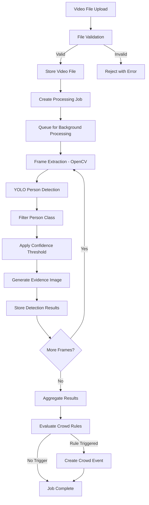

# NEXORA — VisionX AI and Computer Vision Design

**Document ID:** DOC-011  
**Version:** 1.0  
**Status:** Draft  
**Created:** 2026-10-09  
**Last Updated:** 2026-10-09  

---

## 1. Video Ingestion Pipeline



## 2. File Validation

### Validation Steps (Ordered)

| Step | Check | Rejection Condition | Error Message |
|------|-------|---------------------|---------------|
| 1 | File presence | No file in request | "No file uploaded." |
| 2 | File extension | Not in [.mp4, .avi, .mov, .mkv] | "Unsupported file type. Supported: MP4, AVI, MOV, MKV." |
| 3 | MIME type | Does not match expected MIME for extension | "File content does not match declared type." |
| 4 | File size | Exceeds configured max (default 500 MB) | "File exceeds maximum size of {max} MB." |
| 5 | File readability | OpenCV cannot open the file | "Video file is corrupt or unreadable." |
| 6 | Minimum duration | Video shorter than sampling interval | "Video is too short for analysis." |

### MIME Type Mapping
| Extension | Expected MIME Type |
|-----------|-------------------|
| .mp4 | video/mp4 |
| .avi | video/x-msvideo |
| .mov | video/quicktime |
| .mkv | video/x-matroska |

### Filename Sanitisation
```python
import re
import uuid

def sanitise_filename(original: str) -> str:
    """Remove path components and dangerous characters."""
    # Extract basename only
    name = Path(original).name
    # Remove path traversal attempts
    name = name.replace("..", "").replace("/", "").replace("\\", "")
    # Keep only alphanumeric, hyphens, underscores, and dots
    name = re.sub(r'[^\w\-.]', '_', name)
    # Truncate to reasonable length
    name = name[:200]
    return name
```

## 3. Frame Extraction and Sampling

### Extraction Method

```python
import cv2

def extract_frames(video_path: str, interval_sec: float):
    cap = cv2.VideoCapture(video_path)
    if not cap.isOpened():
        raise ValueError("Cannot open video file")
    
    fps = cap.get(cv2.CAP_PROP_FPS)
    total_frames = int(cap.get(cv2.CAP_PROP_FRAME_COUNT))
    duration_sec = total_frames / fps
    
    frame_interval = int(fps * interval_sec)
    
    frame_index = 0
    extracted_count = 0
    
    while True:
        cap.set(cv2.CAP_PROP_POS_FRAMES, frame_index)
        ret, frame = cap.read()
        if not ret:
            break
        
        timestamp = frame_index / fps
        yield frame, extracted_count, timestamp
        
        extracted_count += 1
        frame_index += frame_interval
    
    cap.release()
```

### Sampling Configuration

| Parameter | Default | Range | Description |
|-----------|---------|-------|-------------|
| `sampling_interval_sec` | 2.0 | 0.5–30.0 | Seconds between sampled frames |
| Typical 5-minute video at 2s interval | — | — | ~150 frames to process |
| Typical 5-minute video at 5s interval | — | — | ~60 frames to process |

### Performance Considerations
- Lower interval = more frames = slower but more detailed.
- Higher interval = fewer frames = faster but may miss transient events.
- Default of 2 seconds balances detail and processing time.
- For CPU-only processing at ~45ms/frame (YOLO) + ~10ms/frame (OpenCV): 150 frames ≈ 8 seconds.

## 4. YOLO Model Choice and Licence

### Model Selection: YOLOv8n (Nano)

| Property | Value |
|----------|-------|
| Model | YOLOv8n |
| Parameters | 3.2 million |
| Model file size | ~6.2 MB |
| COCO mAP@50 | 37.3% |
| CPU inference time | ~45ms/frame (640px) |
| Training dataset | COCO (80 classes) |
| Person class | Class 0 |
| Provider | Ultralytics |

### Licence Verification

| Component | Licence | Hackathon Use | Commercial Use |
|-----------|---------|---------------|----------------|
| Ultralytics package | AGPL-3.0 | ✅ Permitted | Requires Ultralytics Enterprise licence |
| YOLOv8 model weights | AGPL-3.0 | ✅ Permitted | Requires Enterprise licence |
| COCO dataset (training) | CC BY 4.0 | ✅ Permitted | ✅ Permitted with attribution |

**Hackathon implication:** AGPL-3.0 requires that the complete source code be made available. For a hackathon prototype with public source code, this is satisfied. Commercial deployment would require an Ultralytics Enterprise licence.

### Alternative Models

| Model | Pros | Cons | Decision |
|-------|------|------|----------|
| YOLOv8s | Better accuracy | 2× slower on CPU | Alternative option |
| YOLOv5 | Well-tested | Older architecture | Not preferred |
| YOLOv8m/l | Best accuracy | Too slow for CPU | Not suitable for prototype |
| MobileNet SSD | Lighter | Lower accuracy for crowds | Not suitable |

## 5. Model Weight Acquisition

### Automatic Download
Ultralytics automatically downloads model weights on first use:

```python
from ultralytics import YOLO
model = YOLO("yolov8n.pt")  # Downloads if not cached
```

### Cache Location
- Default: `~/.cache/ultralytics/` (configurable)
- Size: ~6.2 MB for YOLOv8n
- Persistent across application restarts

### Offline Handling
If model weights cannot be downloaded:
1. Log error: "YOLO model weights not available. Check internet connection."
2. Mark job as failed with error message.
3. Frontend shows: "Model unavailable. Please ensure internet connection for first-time setup."
4. Suggest manual download and placement in cache directory.

### Pre-Download Script
```python
# scripts/download_model.py
from ultralytics import YOLO
print("Downloading YOLOv8n model weights...")
model = YOLO("yolov8n.pt")
print(f"Model downloaded successfully to cache.")
```

## 6. Person-Class Filtering

### COCO Class Mapping
YOLO models trained on COCO classify 80 object classes. Person is class index 0.

```python
PERSON_CLASS_ID = 0

def filter_persons(results):
    """Filter YOLO results to person class only."""
    detections = []
    for result in results:
        boxes = result.boxes
        for i, cls in enumerate(boxes.cls):
            if int(cls) == PERSON_CLASS_ID:
                conf = float(boxes.conf[i])
                box = boxes.xyxy[i].tolist()  # [x1, y1, x2, y2]
                detections.append({
                    "bbox": box,
                    "confidence": conf,
                    "class": "person"
                })
    return detections
```

### Why Only Person Class
- The prototype is designed for crowd density analysis.
- Other COCO classes (vehicles, animals, objects) are not relevant.
- Filtering reduces false count inflation.

## 7. Confidence Threshold Configuration

### Default Threshold: 0.5

| Threshold | Effect | Use Case |
|-----------|--------|----------|
| 0.3 | More detections, more false positives | Dense crowds (accept lower confidence) |
| 0.5 | Balanced accuracy | Default for most scenarios |
| 0.7 | Fewer detections, fewer false positives | Clear footage with distinct individuals |
| 0.9 | Very few detections | Only high-confidence |

### Application
```python
def apply_threshold(detections, threshold=0.5):
    return [d for d in detections if d["confidence"] >= threshold]
```

### User Configuration
- Set per video upload via the `confidence_threshold` parameter.
- Can be adjusted globally in settings.
- Affects only which detections are counted; all raw detections above 0.1 could be stored for later re-analysis (P2 enhancement).

## 8. Bounding Box Generation

### Format
Bounding boxes are in **pixel coordinates** (x1, y1, x2, y2):
- `x1, y1`: Top-left corner
- `x2, y2`: Bottom-right corner

### Storage
```json
{
    "bbox": [245.5, 120.3, 310.2, 380.8],
    "confidence": 0.87,
    "class": "person"
}
```

### Normalisation
For evidence images, bounding boxes are drawn on the original frame resolution. No normalisation is needed.

## 9. Person Counts Per Frame

### Counting Method
```python
person_count = len(filtered_detections)
```

### Aggregation Statistics per Job
After all frames are processed:
- `total_persons_detected`: Sum of person counts across all frames.
- `max_person_count`: Maximum count in any single frame.
- `avg_person_count`: Mean count across all frames.
- `min_person_count`: Minimum count (for completeness).

### Interpretation Warning
> Person counts represent the number of **detections** by the YOLO model, not necessarily the exact number of people present. Counts may be lower than actual due to occlusion, and higher in rare cases due to false positives. Dense crowd accuracy has not been validated for this prototype.

## 10. Evidence Image Generation

### Process
```python
import cv2

def generate_evidence_image(frame, detections, output_path):
    """Draw bounding boxes on frame and save as evidence."""
    evidence = frame.copy()
    
    for det in detections:
        x1, y1, x2, y2 = [int(v) for v in det["bbox"]]
        conf = det["confidence"]
        
        # Draw bounding box
        cv2.rectangle(evidence, (x1, y1), (x2, y2), (0, 255, 0), 2)
        
        # Draw confidence label
        label = f"Person {conf:.2f}"
        cv2.putText(evidence, label, (x1, y1 - 10),
                    cv2.FONT_HERSHEY_SIMPLEX, 0.5, (0, 255, 0), 1)
    
    # Draw count overlay
    count_text = f"Count: {len(detections)}"
    cv2.putText(evidence, count_text, (10, 30),
                cv2.FONT_HERSHEY_SIMPLEX, 1.0, (0, 0, 255), 2)
    
    # Save as JPEG
    cv2.imwrite(output_path, evidence, [cv2.IMWRITE_JPEG_QUALITY, 85])
```

### Evidence Image Properties
| Property | Value |
|----------|-------|
| Format | JPEG (85% quality) |
| Resolution | Same as source video frame |
| Annotations | Green bounding boxes, confidence labels, count overlay |
| Storage | `data/evidence/{job_id}/frame_{index:06d}.jpg` |
| Typical size | 50–200 KB per image |

### Storage Considerations
For a 5-minute video at 2-second intervals:
- ~150 evidence images
- ~150 × 100 KB = ~15 MB per video
- Manageable for prototype scale

## 11. Timestamp Handling

### Video Timestamps
- Frame timestamps are calculated as: `timestamp_sec = frame_index / fps`
- Stored as floating-point seconds from video start.
- Displayed in the UI as `MM:SS.mmm` format.

### Accuracy
- Timestamp accuracy depends on video FPS and seeking accuracy.
- OpenCV `CAP_PROP_POS_FRAMES` seeking may have minor inaccuracies with some codecs.
- For prototype purposes, this is acceptable.

## 12. Crowd-Count Aggregation

### Per-Frame Data
After processing, each sampled frame has:
- Frame index, timestamp, person count, confidence statistics, evidence image path.

### Timeline Construction
The frontend renders a timeline chart using the per-frame data:
- X-axis: Timestamp (seconds or MM:SS)
- Y-axis: Person count
- Reference line: Configured threshold

### Aggregation for Events
The crowd rules engine evaluates the complete set of per-frame counts for a job.

## 13. Threshold-Based Event Rules

### Rule 1: Simple Threshold

**Condition:** Person count in any single frame exceeds `threshold_count`.

```python
def evaluate_threshold_rule(detections, threshold):
    events = []
    for det in detections:
        if det.person_count > threshold:
            events.append(create_event(
                detection=det,
                rule_type="threshold",
                severity=calculate_severity(det.person_count, threshold)
            ))
    return events
```

**Configuration:**
- `CROWD_THRESHOLD_COUNT`: Default 50 (configurable via settings).

**De-duplication:** If multiple consecutive frames trigger, only the peak frame generates an event (the frame with the highest count in a triggered sequence).

### Rule 2: Sustained High Count (P1)

**Condition:** Person count exceeds `threshold_count` for `sustained_frames` or more consecutive sampled frames.

```python
def evaluate_sustained_rule(detections, threshold, min_frames):
    events = []
    consecutive_count = 0
    peak_detection = None
    
    for det in sorted(detections, key=lambda d: d.frame_index):
        if det.person_count > threshold:
            consecutive_count += 1
            if peak_detection is None or det.person_count > peak_detection.person_count:
                peak_detection = det
        else:
            if consecutive_count >= min_frames and peak_detection:
                events.append(create_event(
                    detection=peak_detection,
                    rule_type="sustained",
                    sustained_frames=consecutive_count,
                    severity=calculate_severity(peak_detection.person_count, threshold)
                ))
            consecutive_count = 0
            peak_detection = None
    
    # Handle sequence that extends to end of video
    if consecutive_count >= min_frames and peak_detection:
        events.append(create_event(
            detection=peak_detection,
            rule_type="sustained",
            sustained_frames=consecutive_count,
            severity=calculate_severity(peak_detection.person_count, threshold)
        ))
    
    return events
```

**Configuration:**
- `SUSTAINED_FRAME_COUNT`: Default 3 (configurable).

## 14. Severity Calculation

```python
def calculate_severity(count, threshold):
    ratio = count / threshold
    if ratio >= 2.0:
        return "critical"
    elif ratio >= 1.5:
        return "high"
    elif ratio >= 1.0:
        return "medium"
    else:
        return "low"
```

| Ratio (count / threshold) | Severity | Example (threshold=50) |
|---------------------------|----------|----------------------|
| ≥ 2.0 | Critical | count ≥ 100 |
| ≥ 1.5 | High | count ≥ 75 |
| ≥ 1.0 | Medium | count ≥ 50 |
| < 1.0 | Low | count < 50 (should not generate event) |

## 15. Job Progress and Failure Recovery

### Progress Tracking
- Total frames to process is calculated at start: `total = video_duration / sampling_interval`.
- After each frame, update progress: `progress = frames_processed / total_frames`.
- Progress stored in database and queryable via API.

### Failure Scenarios

| Failure | Detection | Recovery |
|---------|-----------|----------|
| Corrupt frame | OpenCV read returns False | Skip frame, log warning, continue |
| YOLO inference error | Exception during predict | Log error, mark frame as failed, continue |
| Out of memory | MemoryError | Catch, mark job failed, suggest smaller model or lower resolution |
| Disk full | IOError on evidence save | Catch, mark job failed, log error |
| Process crash | Job stuck in "processing" | Startup check: if job is "processing" for > timeout, mark as failed |

### Stale Job Detection
```python
STALE_JOB_TIMEOUT_MINUTES = 30

def check_stale_jobs():
    stale = db.query(VideoJob).filter(
        VideoJob.status == "processing",
        VideoJob.started_at < datetime.utcnow() - timedelta(minutes=STALE_JOB_TIMEOUT_MINUTES)
    ).all()
    for job in stale:
        job.status = "failed"
        job.error_message = "Processing timed out. Job may need to be retried."
```

## 16. CPU/GPU Considerations

### CPU Mode (Default)

| Metric | Value |
|--------|-------|
| YOLO inference per frame | ~45ms (YOLOv8n, 640px) |
| Frame extraction per frame | ~10ms |
| Evidence generation per frame | ~15ms |
| Total per frame | ~70ms |
| 150 frames (5-min video) | ~10.5 seconds |

### GPU Mode (Optional)

| Metric | Value |
|--------|-------|
| YOLO inference per frame | ~5ms (YOLOv8n, CUDA) |
| Total per frame | ~30ms |
| 150 frames (5-min video) | ~4.5 seconds |

### GPU Detection
```python
import torch

def get_device():
    if torch.cuda.is_available():
        return "cuda"
    return "cpu"
```

### Recommendation
- CPU mode is the default and must always work.
- GPU mode is a nice-to-have that requires CUDA toolkit.
- Document GPU setup as optional enhancement.

## 17. Performance Measurement

### Metrics to Capture

| Metric | Measurement Method |
|--------|-------------------|
| Total processing time | End timestamp - start timestamp |
| Frames per second | Total frames / processing duration |
| Average inference time | Sum of inference times / frame count |
| Memory usage | Peak RSS during processing |

### Benchmarking
Performance benchmarks should be measured with:
- A standard test video (documented resolution, duration, frame rate).
- CPU model and clock speed noted.
- Results recorded (not invented).

## 18. Privacy Controls

### What VisionX Does NOT Do
- ❌ Face detection or recognition
- ❌ Individual tracking or re-identification
- ❌ Gender, age, or demographic classification
- ❌ Emotion or behaviour analysis
- ❌ Gait analysis or biometric identification
- ❌ License plate or text recognition
- ❌ Storage of identifying features

### What VisionX Does
- ✅ Detects persons as bounding boxes (not identifiable)
- ✅ Counts people per frame
- ✅ Stores annotated images with bounding boxes
- ✅ Associates counts with zones and timestamps

### Evidence Image Privacy
- Evidence images contain bounding boxes but the underlying video frame may show individuals.
- Evidence images should be treated as sensitive data.
- Access is restricted to operators via the API (not publicly accessible).
- Evidence images can be deleted as part of demo reset.

### Authorised Footage
The system is designed for analysis of **authorised, prerecorded footage** only. The operator is responsible for ensuring that:
- Video footage is collected with appropriate authorisation.
- Privacy regulations are followed for the jurisdiction.
- Footage is not used for individual identification.

## 19. Limitations and Known Failure Cases

### Detection Limitations

| Limitation | Impact | Mitigation |
|-----------|--------|------------|
| **Occlusion** | Partially hidden persons may not be detected | Acknowledge in event descriptions |
| **Dense crowds** | Severely overlapping persons reduce accuracy significantly | Document: counts in dense crowds are underestimates |
| **Small persons** | Distant or small figures may be missed | Use higher-resolution input when possible |
| **Unusual poses** | People lying down, crouching may not be detected | Document limitation |
| **Lighting conditions** | Poor lighting reduces detection accuracy | Note in evidence review |
| **Camera angle** | Extreme angles (e.g., directly overhead) affect detection | Test with representative angles |
| **Motion blur** | Fast-moving people in frames may be missed | Use shorter sampling intervals |

### What Cannot Be Detected

| Claim | Status | Explanation |
|-------|--------|-------------|
| Panic | ❌ Not supported | Would require validated behaviour analysis model |
| Stampede | ❌ Not supported | Would require motion flow analysis and validation |
| Violence | ❌ Not supported | Would require action recognition model |
| Anomaly | ❌ Not supported | Would require baseline behaviour modelling |
| Crowd density (per sq.m.) | ❌ Not supported | Would require calibrated camera and area estimation |
| Emotion | ❌ Not supported | Would require face analysis (privacy concern) |
| Crowd flow direction | ❌ Not supported | Would require tracking across frames |

## 20. AI Evaluation Plan

### Evaluation Goals
Before claiming detection accuracy, the following evaluation should be conducted:

1. **Test Dataset:** Collect or identify a set of test images/video with ground-truth person counts.
2. **Metrics:**
   - Precision: What fraction of detections are actual persons?
   - Recall: What fraction of actual persons are detected?
   - Count accuracy: |detected count - true count| / true count
3. **Conditions:** Evaluate across varying crowd densities, lighting, angles.
4. **Reporting:** Document results honestly, including failure cases.

### Prototype Status
For the hackathon prototype:
- No formal evaluation has been conducted.
- YOLO's published COCO benchmarks provide baseline expectations.
- Demo videos should be chosen for reasonable detection conditions (not extreme density).
- Limitations must be disclosed in the demo presentation.

### Future Evaluation Tasks
- Annotate test frames with ground-truth bounding boxes.
- Calculate precision, recall, and F1 at the configured threshold.
- Test with dense crowd footage and document accuracy degradation.
- Compare YOLOv8n vs. YOLOv8s for the specific use case.

---

*End of Document 11 — VisionX AI and Computer Vision Design*
