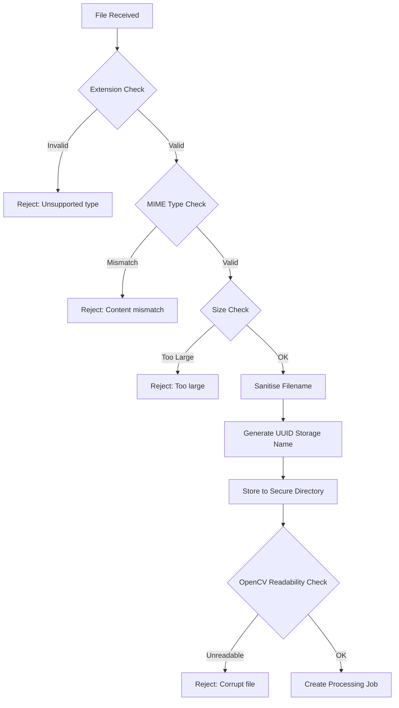

# NEXORA — Security, Privacy and Responsible-Use Plan

**Document ID:** DOC-012  
**Version:** 1.0  
**Status:** Draft  
**Created:** 2026-10-09  
**Last Updated:** 2026-10-09  

---

## 1. Security Overview

NEXORA is a hackathon prototype designed for local development deployment. Security measures are proportionate to this context but follow good practices that can be extended for production.

### Threat Model Summary

| Threat | Risk Level | Mitigation |
|--------|-----------|------------|
| Malicious file upload | Medium | File type, size, and content validation |
| Path traversal via upload | Medium | Filename sanitisation, server-side path construction |
| API input injection | Low-Medium | Pydantic validation, parameterised queries |
| Unauthorized access | Low (single-user prototype) | Simulated auth; real auth deferred |
| Data exposure via error messages | Low | Sanitised error responses |
| CORS exploitation | Low | Restrictive CORS configuration |
| Credential exposure | Medium | Environment variables, .gitignore |
| Denial of service (large uploads) | Low | File size limits |

## 2. Video Upload Threat Model

### Attack Vectors

| Attack | Description | Mitigation |
|--------|-------------|------------|
| **Malicious file disguised as video** | Attacker uploads executable or script with .mp4 extension | MIME type verification + extension check |
| **Oversized file** | Extremely large file to exhaust disk space | Configurable max file size (default 500 MB) |
| **Path traversal filename** | Filename like `../../etc/passwd` | Filename sanitisation + server-generated storage name |
| **Zip bomb / decompression bomb** | Compressed file that expands massively | Not applicable (raw video, not compressed archive) |
| **Video with embedded malware** | Video file with exploit payload | OpenCV processes as pixel data; no execution |
| **Rapid repeated uploads** | Flood server with uploads | Basic rate limiting (future: proper rate limiter) |

### Upload Validation Pipeline



## 3. File Type and Size Validation

### Implementation

```python
import magic  # python-magic for MIME type detection

ALLOWED_EXTENSIONS = {".mp4", ".avi", ".mov", ".mkv"}
ALLOWED_MIMES = {
    "video/mp4", "video/x-msvideo", "video/quicktime",
    "video/x-matroska"
}
MAX_FILE_SIZE_MB = int(os.getenv("MAX_UPLOAD_SIZE_MB", "500"))
MAX_FILE_SIZE_BYTES = MAX_FILE_SIZE_MB * 1024 * 1024

def validate_upload(file):
    # Extension check
    ext = Path(file.filename).suffix.lower()
    if ext not in ALLOWED_EXTENSIONS:
        raise HTTPException(415, "Unsupported file type")
    
    # Size check (stream-based)
    content = file.file.read()
    if len(content) > MAX_FILE_SIZE_BYTES:
        raise HTTPException(413, f"File exceeds {MAX_FILE_SIZE_MB} MB limit")
    
    # MIME check
    mime = magic.from_buffer(content[:2048], mime=True)
    if mime not in ALLOWED_MIMES:
        raise HTTPException(415, "File content does not match declared type")
    
    file.file.seek(0)  # Reset for storage
    return content
```

**Note:** `python-magic` may require `libmagic` on some systems. If unavailable, fallback to extension-only validation with a documented warning.

## 4. Safe File Naming and Storage

### Filename Sanitisation
1. Extract basename only (remove any path components).
2. Remove `..`, `/`, `\` characters.
3. Replace non-alphanumeric characters (except `-`, `_`, `.`) with underscores.
4. Truncate to 200 characters.
5. Store original filename in database for display.

### Storage Path Construction
```python
from pathlib import Path
import uuid

def get_storage_path(job_id: str, extension: str) -> Path:
    base_dir = Path(os.getenv("DATA_DIR", "data"))
    upload_dir = base_dir / "uploads" / job_id
    upload_dir.mkdir(parents=True, exist_ok=True)
    return upload_dir / f"video{extension}"
```

**Critical:** The `job_id` is a UUID generated server-side. No user input is used in path construction.

## 5. Path Traversal Prevention

### Rules
1. **Never** use user-supplied strings in filesystem paths.
2. **Always** construct paths from server-generated components (UUIDs, indices).
3. **Always** use `pathlib.Path` for path construction (prevents injection).
4. **Validate** that resolved paths remain within the data directory.

```python
def safe_resolve(base_dir: Path, relative: str) -> Path:
    """Ensure resolved path is within base directory."""
    full_path = (base_dir / relative).resolve()
    if not str(full_path).startswith(str(base_dir.resolve())):
        raise ValueError("Path traversal detected")
    return full_path
```

## 6. Protection of Uploaded Media and Evidence

### Access Control

| File Type | Access Method | Protection |
|-----------|--------------|------------|
| Uploaded videos | Not served via HTTP | Backend internal use only |
| Evidence images | Served via `/api/v1/evidence/{job_id}/{filename}` | Endpoint validates job existence |
| Venue config | Internal configuration | Not exposed via API |

### Evidence Endpoint Security
```python
@router.get("/evidence/{job_id}/{filename}")
async def get_evidence(job_id: str, filename: str, db: Session):
    # Validate job exists
    job = db.query(VideoJob).filter(VideoJob.id == job_id).first()
    if not job:
        raise HTTPException(404, "Not found")
    
    # Validate filename format
    if not re.match(r'^frame_\d{6}\.(jpg|png)$', filename):
        raise HTTPException(400, "Invalid filename")
    
    # Construct safe path
    file_path = safe_resolve(evidence_dir, f"{job_id}/{filename}")
    
    if not file_path.exists():
        raise HTTPException(404, "Not found")
    
    return FileResponse(file_path, media_type="image/jpeg")
```

## 7. Access Control Design

### MVP: Simulated Authentication

For the prototype:
- No real authentication is implemented.
- The `X-Operator` header identifies the operator for audit logging.
- Default operator: `"operator"`.
- All API endpoints are accessible without credentials.

### Future: Role-Based Access Control

| Role | Permissions |
|------|------------|
| Operator | Full CRUD on all entities |
| Commander | Read all, update incidents only |
| Viewer | Read-only access |
| Admin | All permissions + settings management |

### Deferred Authentication
- Authentication is explicitly out of scope for MVP.
- See ADR-006 for the rationale.
- When implemented, JWT or session-based auth with a user database would be appropriate.

## 8. Secrets Management

### Environment Variables

```bash
# .env.example (committed to repo)
DATABASE_URL=sqlite:///data/nexora.db
DATA_DIR=data
MAX_UPLOAD_SIZE_MB=500
YOLO_MODEL=yolov8n.pt
CROWD_THRESHOLD_COUNT=50
SUSTAINED_FRAME_COUNT=3
DEFAULT_SAMPLING_INTERVAL=2.0
DEFAULT_CONFIDENCE_THRESHOLD=0.5
CORS_ORIGINS=http://localhost:5173
API_HOST=0.0.0.0
API_PORT=8000
LOG_LEVEL=INFO
```

### .gitignore Rules
```gitignore
# Secrets
.env

# Uploaded files
data/uploads/
data/evidence/

# Database
*.db
*.db-journal
*.db-wal

# Model weights
*.pt
*.onnx

# Python
__pycache__/
*.pyc
.venv/
venv/

# Node
node_modules/
dist/

# IDE
.vscode/
.idea/
```

### Rules
- **Never** commit `.env` files with real secrets.
- **Always** provide `.env.example` with placeholder values.
- **Never** commit model weight files (large + licensed).
- **Never** commit uploaded video files.

## 9. API Validation

### Pydantic Validation
All API inputs are validated through Pydantic models:

```python
from pydantic import BaseModel, Field, validator

class VideoUploadParams(BaseModel):
    zone_id: str | None = None
    sampling_interval: float = Field(default=2.0, ge=0.5, le=30.0)
    confidence_threshold: float = Field(default=0.5, ge=0.1, le=1.0)

class EventReviewRequest(BaseModel):
    action: Literal["acknowledge", "dismiss", "escalate"]
    notes: str | None = Field(default=None, max_length=1000)

class IncidentCreateRequest(BaseModel):
    title: str = Field(..., min_length=5, max_length=200)
    description: str | None = Field(default=None, max_length=2000)
    zone_id: str | None = None
    event_id: str | None = None
    priority: Literal["low", "medium", "high", "critical"]
```

### Validation Error Response
FastAPI/Pydantic returns structured validation errors:
```json
{
    "detail": [
        {
            "loc": ["body", "title"],
            "msg": "string too short",
            "type": "string_too_short"
        }
    ]
}
```

## 10. CORS Configuration

```python
from fastapi.middleware.cors import CORSMiddleware

app.add_middleware(
    CORSMiddleware,
    allow_origins=os.getenv("CORS_ORIGINS", "http://localhost:5173").split(","),
    allow_credentials=True,
    allow_methods=["GET", "POST", "PUT", "DELETE"],
    allow_headers=["*"],
)
```

### Production CORS
For production, `CORS_ORIGINS` should be set to the exact frontend origin only.

## 11. Error Message Safety

### Internal Errors
```python
@app.exception_handler(Exception)
async def generic_exception_handler(request, exc):
    # Log full details server-side
    logger.error(f"Internal error: {exc}", exc_info=True)
    
    # Return generic message to client
    return JSONResponse(
        status_code=500,
        content={
            "error": {
                "code": "INTERNAL_ERROR",
                "message": "An unexpected error occurred. Please try again."
            }
        }
    )
```

### Rules
- **Never** expose stack traces, file paths, or SQL queries in API responses.
- **Always** log full error details server-side.
- **Provide** helpful but non-revealing error messages to users.

## 12. Audit Logging

### Actions Logged

| Action | Entity | Details |
|--------|--------|---------|
| `video_uploaded` | video_job | Filename, zone, size |
| `video_processing_started` | video_job | Model, settings |
| `video_processing_completed` | video_job | Duration, frame count |
| `video_processing_failed` | video_job | Error message |
| `event_created` | event | Rule type, count, severity |
| `event_reviewed` | event | Action (ack/dismiss/escalate), notes |
| `incident_created` | incident | Title, zone, priority, linked event |
| `incident_status_changed` | incident | Old status, new status |
| `resource_assigned` | incident | Resource name, type |
| `resource_released` | resource | Previous incident |
| `walkway_blocked` | edge | Edge ID, reason |
| `walkway_reopened` | edge | Edge ID |
| `demo_reset` | system | Operator, timestamp |

### Audit Log Entry Structure
```python
def create_audit_entry(
    action: str,
    entity_type: str,
    entity_id: str,
    operator: str = "operator",
    details: dict = None
):
    entry = AuditLog(
        id=str(uuid.uuid4()),
        action=action,
        entity_type=entity_type,
        entity_id=entity_id,
        operator=operator,
        details=json.dumps(details) if details else None,
        created_at=datetime.utcnow()
    )
    db.add(entry)
```

## 13. Data Retention and Deletion

| Data | Retention | Deletion Trigger |
|------|-----------|-----------------|
| Videos | Until operator deletes or demo reset | Explicit action |
| Evidence images | Tied to video job lifecycle | Cascade with job deletion |
| Detection results | Tied to video job lifecycle | Cascade with job deletion |
| Events | Independent of job (SET NULL on job deletion) | Manual or demo reset |
| Incidents | Retained independently | Status: closed (archival) |
| Audit logs | Never deleted in normal operation | Demo reset only |
| Venue data | Reset to configuration defaults | Configuration reload |

### Demo Reset
A demo reset endpoint clears all operational data while preserving venue configuration.
This action requires confirmation and is itself logged.

## 14. Privacy by Design

### Principles Applied

| Principle | Implementation |
|-----------|---------------|
| Data minimisation | Only bounding boxes stored, not face data |
| Purpose limitation | Video analysis for crowd counting only |
| Storage limitation | Evidence images deletable; no permanent PII storage |
| Authorised access | Evidence served through validated API endpoints |
| Transparency | All automated actions visible to operator |
| Human oversight | All events require human review |

### What Is NOT Collected
- Names or identities of individuals
- Facial features or biometric data
- Demographic information
- Behavioural patterns or tracking data
- Audio data from video
- GPS or location data of individuals

## 15. Avoidance of Face Recognition

### Technical Measures
- No face detection model is loaded or used.
- YOLO detects full-body "person" class only.
- No face-related YOLO classes are enabled.
- No additional face detection libraries are included.
- Evidence images show bounding boxes around full bodies, not faces.

### Policy
NEXORA explicitly does not support and must not be extended to support:
- Facial recognition or identification
- Individual tracking or re-identification
- Demographic profiling
- Emotion or sentiment analysis based on facial features

## 16. Authorised Footage Requirements

The system is designed for **authorised, prerecorded video footage** provided by an operator who has the legal right to process it.

### Operator Responsibilities
- Ensure footage is collected with appropriate consent or legal authority.
- Comply with applicable privacy regulations (GDPR, India's DPDP Act, etc.).
- Not use the system for surveillance of individuals.
- Not upload footage containing minors without appropriate authorisation.

### System Disclaimers
The upload interface includes a notice:
> "By uploading this video, you confirm that you have authorisation to process this footage for crowd density analysis."

## 17. Limitations on Automated Alerts

### What Alerts Represent
- High person count detected in a video frame.
- **Not:** An emergency, danger, or safety threat.
- **Not:** A validated crowd safety concern.

### Human Review Requirement
- All automated events are created with status `pending_review`.
- No automated action is taken without operator review.
- The operator must explicitly acknowledge, dismiss, or escalate.
- The system does not send external notifications or trigger external systems automatically.

### Responsible Language
Event descriptions use neutral, factual language:
- ✅ "High person count detected: 78 persons (threshold: 50)"
- ❌ "DANGER: Stampede risk detected!"
- ❌ "Emergency: Crowd crush imminent"

## 18. Demo Environment Security

### Acceptable for Demo
- SQLite database (no network exposure)
- Local file storage (no cloud exposure)
- Simulated authentication (acknowledged in documentation)
- Sample/demo data (not real event data)

### Not Acceptable Even for Demo
- Committing real credentials to repository
- Using real emergency footage without authorisation
- Claiming production-grade security
- Leaving debug mode enabled in presentation
- Exposing the development server to public internet

---

*End of Document 12 — Security, Privacy and Responsible-Use Plan*
