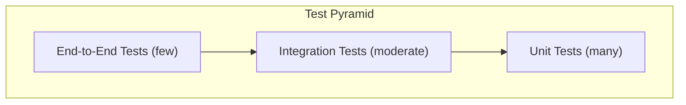

# NEXORA — Test Strategy and Test Cases

**Document ID:** DOC-013  
**Version:** 1.0  
**Status:** Draft  
**Created:** 2026-10-09  
**Last Updated:** 2026-10-09  

---

## 1. Testing Overview

### Testing Pyramid



| Level | Tool | Focus | Quantity |
|-------|------|-------|----------|
| Unit | Pytest (backend), Vitest (frontend) | Individual functions, components | Many (50+) |
| Integration | Pytest + httpx TestClient | API endpoints, DB operations | Moderate (30+) |
| Component | React Testing Library | UI component behaviour | Moderate (20+) |
| E2E | Manual + Playwright (optional) | Full workflow validation | Few (5-10) |

### Test Environment
- **Database:** In-memory SQLite for unit/integration tests (`:memory:`).
- **Video files:** Small test video files (~1 MB) included in `tests/fixtures/`.
- **YOLO model:** Mocked for unit tests; real model for integration tests.
- **File storage:** Temporary directory for test evidence images.

## 2. Unit Testing

### Backend Unit Tests

| Test Area | File | Coverage |
|-----------|------|----------|
| File validation | `tests/unit/test_file_validation.py` | Extension, MIME, size checks |
| Filename sanitisation | `tests/unit/test_filename_sanitise.py` | Path traversal, special characters |
| Frame extraction | `tests/unit/test_frame_extraction.py` | OpenCV frame extraction |
| Person detection filtering | `tests/unit/test_detection_filter.py` | Class filtering, confidence threshold |
| Crowd rule evaluation | `tests/unit/test_crowd_rules.py` | Threshold, sustained count |
| Severity calculation | `tests/unit/test_severity.py` | Severity level computation |
| Route cost calculation | `tests/unit/test_route_cost.py` | Cost formula |
| Graph construction | `tests/unit/test_graph.py` | Node/edge loading |
| Incident state machine | `tests/unit/test_incident_states.py` | Valid/invalid transitions |
| Audit logging | `tests/unit/test_audit.py` | Entry creation |

### Frontend Component Tests

| Component | File | Tests |
|-----------|------|-------|
| StatusBadge | `src/__tests__/StatusBadge.test.tsx` | Renders correct colour/label for each status |
| MetricCard | `src/__tests__/MetricCard.test.tsx` | Displays value, label, trend |
| ConfirmDialog | `src/__tests__/ConfirmDialog.test.tsx` | Open/close, confirm/cancel callbacks |
| EmptyState | `src/__tests__/EmptyState.test.tsx` | Renders message and CTA |
| EventCard | `src/__tests__/EventCard.test.tsx` | Displays event data, click handler |
| UploadDropzone | `src/__tests__/UploadDropzone.test.tsx` | File selection, validation feedback |

## 3. API Integration Testing

### Test Infrastructure
```python
# tests/conftest.py
import pytest
from fastapi.testclient import TestClient
from sqlalchemy import create_engine
from sqlalchemy.orm import sessionmaker

@pytest.fixture
def test_db():
    engine = create_engine("sqlite:///:memory:")
    Base.metadata.create_all(engine)
    Session = sessionmaker(bind=engine)
    session = Session()
    yield session
    session.close()

@pytest.fixture
def client(test_db):
    app.dependency_overrides[get_db] = lambda: test_db
    return TestClient(app)
```

## 4. Test Cases

### TC-001: Valid Video Upload

| Field | Value |
|-------|-------|
| **ID** | TC-001 |
| **Title** | Valid MP4 video upload succeeds |
| **Priority** | P0 |
| **Category** | Integration |
| **Preconditions** | Server running, test MP4 file available |
| **Steps** | 1. POST `/api/v1/videos/upload` with valid MP4 file (< 500 MB). 2. Include `zone_id=zone_main_gate`. |
| **Expected Result** | 201 response with job_id. Job status is "queued". File stored on disk. Audit log entry created. |
| **Pass/Fail** | NOT EXECUTED |

### TC-002: Invalid File Type Rejected

| Field | Value |
|-------|-------|
| **ID** | TC-002 |
| **Title** | Upload of non-video file type is rejected |
| **Priority** | P0 |
| **Category** | Integration |
| **Preconditions** | Server running |
| **Steps** | 1. POST `/api/v1/videos/upload` with a .exe file renamed to .mp4. |
| **Expected Result** | 415 response. No file stored. No job created. |
| **Pass/Fail** | NOT EXECUTED |

### TC-003: Oversized File Rejected

| Field | Value |
|-------|-------|
| **ID** | TC-003 |
| **Title** | Upload exceeding size limit is rejected |
| **Priority** | P0 |
| **Category** | Integration |
| **Preconditions** | MAX_UPLOAD_SIZE_MB set to a low value for testing |
| **Steps** | 1. POST `/api/v1/videos/upload` with file exceeding configured limit. |
| **Expected Result** | 413 response. No file stored. No job created. |
| **Pass/Fail** | NOT EXECUTED |

### TC-004: Path Traversal Filename Sanitised

| Field | Value |
|-------|-------|
| **ID** | TC-004 |
| **Title** | Malicious filename is sanitised |
| **Priority** | P0 |
| **Category** | Unit |
| **Preconditions** | None |
| **Steps** | 1. Call sanitise_filename with `"../../etc/passwd.mp4"`. 2. Call with `"video<script>.mp4"`. |
| **Expected Result** | All path components removed. Special characters replaced. Safe filename returned. |
| **Pass/Fail** | NOT EXECUTED |

### TC-005: Failed Video Processing

| Field | Value |
|-------|-------|
| **ID** | TC-005 |
| **Title** | Corrupt video file results in failed job |
| **Priority** | P0 |
| **Category** | Integration |
| **Preconditions** | Corrupt test video file available |
| **Steps** | 1. Upload corrupt video file. 2. Wait for processing. |
| **Expected Result** | Job status changes to "failed". Error message stored. No detection results. API returns failed status. |
| **Pass/Fail** | NOT EXECUTED |

### TC-006: Empty Detection Results

| Field | Value |
|-------|-------|
| **ID** | TC-006 |
| **Title** | Video with no people produces zero-count results |
| **Priority** | P0 |
| **Category** | Integration |
| **Preconditions** | Test video with no people available |
| **Steps** | 1. Upload video with no people. 2. Wait for processing. |
| **Expected Result** | Job completes. Detection results have person_count=0 for all frames. No events generated. |
| **Pass/Fail** | NOT EXECUTED |

### TC-007: YOLO Person Detection

| Field | Value |
|-------|-------|
| **ID** | TC-007 |
| **Title** | YOLO detects persons in test image |
| **Priority** | P0 |
| **Category** | Unit |
| **Preconditions** | YOLO model available. Test image with known persons. |
| **Steps** | 1. Run YOLO detection on test image with visible persons. 2. Filter for person class. |
| **Expected Result** | At least one person detected. Bounding boxes returned. Confidence > 0.5. |
| **Pass/Fail** | NOT EXECUTED |

### TC-008: Confidence Threshold Filtering

| Field | Value |
|-------|-------|
| **ID** | TC-008 |
| **Title** | Detections below confidence threshold are excluded |
| **Priority** | P0 |
| **Category** | Unit |
| **Preconditions** | Mock detections with varied confidence |
| **Steps** | 1. Apply threshold 0.5 to detections with conf [0.3, 0.5, 0.7, 0.9]. |
| **Expected Result** | Only 3 detections retained (0.5, 0.7, 0.9). Count = 3. |
| **Pass/Fail** | NOT EXECUTED |

### TC-009: Crowd Threshold Rule — Below Threshold

| Field | Value |
|-------|-------|
| **ID** | TC-009 |
| **Title** | No event generated when count is below threshold |
| **Priority** | P0 |
| **Category** | Unit |
| **Preconditions** | Threshold = 50. Detection results with max count = 45. |
| **Steps** | 1. Evaluate threshold rule with all counts ≤ 50. |
| **Expected Result** | No events generated. |
| **Pass/Fail** | NOT EXECUTED |

### TC-010: Crowd Threshold Rule — Above Threshold

| Field | Value |
|-------|-------|
| **ID** | TC-010 |
| **Title** | Event generated when count exceeds threshold |
| **Priority** | P0 |
| **Category** | Unit |
| **Preconditions** | Threshold = 50. Detection results with one frame count = 55. |
| **Steps** | 1. Evaluate threshold rule. |
| **Expected Result** | One event generated. Event count = 55. Status = pending_review. |
| **Pass/Fail** | NOT EXECUTED |

### TC-011: Crowd Threshold Rule — Boundary

| Field | Value |
|-------|-------|
| **ID** | TC-011 |
| **Title** | Event NOT generated when count equals threshold exactly |
| **Priority** | P0 |
| **Category** | Unit |
| **Preconditions** | Threshold = 50. Frame with count = 50. |
| **Steps** | 1. Evaluate threshold rule (condition: count > threshold). |
| **Expected Result** | No event generated (count must exceed, not equal). |
| **Pass/Fail** | NOT EXECUTED |

### TC-012: Sustained Count Rule

| Field | Value |
|-------|-------|
| **ID** | TC-012 |
| **Title** | Sustained event generated for consecutive high frames |
| **Priority** | P1 |
| **Category** | Unit |
| **Preconditions** | Threshold=50, sustained=3. Frames: [30, 55, 60, 70, 40]. |
| **Steps** | 1. Evaluate sustained rule. |
| **Expected Result** | One sustained event generated. sustained_frames=3. |
| **Pass/Fail** | NOT EXECUTED |

### TC-013: Event Review — Acknowledge

| Field | Value |
|-------|-------|
| **ID** | TC-013 |
| **Title** | Operator acknowledges a pending event |
| **Priority** | P0 |
| **Category** | Integration |
| **Preconditions** | Event with status pending_review exists. |
| **Steps** | 1. PUT `/api/v1/events/{id}/review` with action=acknowledge. |
| **Expected Result** | Event status = acknowledged. Audit log entry created. |
| **Pass/Fail** | NOT EXECUTED |

### TC-014: Event Review — Already Reviewed

| Field | Value |
|-------|-------|
| **ID** | TC-014 |
| **Title** | Cannot review an already-reviewed event |
| **Priority** | P0 |
| **Category** | Integration |
| **Preconditions** | Event with status acknowledged exists. |
| **Steps** | 1. PUT `/api/v1/events/{id}/review` with action=dismiss. |
| **Expected Result** | 409 Conflict response. Status unchanged. |
| **Pass/Fail** | NOT EXECUTED |

### TC-015: Route Calculation — Normal

| Field | Value |
|-------|-------|
| **ID** | TC-015 |
| **Title** | Route calculated between connected nodes |
| **Priority** | P0 |
| **Category** | Integration |
| **Preconditions** | Venue graph loaded with connected nodes. |
| **Steps** | 1. GET `/api/v1/routes/compare?from_node=gate_main&to_node=exit_north`. |
| **Expected Result** | At least 1 route returned. Cost breakdown included. Path is valid. |
| **Pass/Fail** | NOT EXECUTED |

### TC-016: Route After Blocking Walkway

| Field | Value |
|-------|-------|
| **ID** | TC-016 |
| **Title** | Route recalculates after walkway is blocked |
| **Priority** | P0 |
| **Category** | Integration |
| **Preconditions** | Route exists via walkway A. |
| **Steps** | 1. Calculate route (includes walkway A). 2. Block walkway A. 3. Recalculate route. |
| **Expected Result** | New route does not include blocked walkway. Route cost may differ. |
| **Pass/Fail** | NOT EXECUTED |

### TC-017: Route After Reopening Walkway

| Field | Value |
|-------|-------|
| **ID** | TC-017 |
| **Title** | Reopened walkway is included in route calculations |
| **Priority** | P0 |
| **Category** | Integration |
| **Preconditions** | Walkway is blocked. |
| **Steps** | 1. Reopen walkway. 2. Calculate route. |
| **Expected Result** | Reopened walkway eligible for routing again. |
| **Pass/Fail** | NOT EXECUTED |

### TC-018: Disconnected Graph — No Route

| Field | Value |
|-------|-------|
| **ID** | TC-018 |
| **Title** | No-route message when graph is disconnected |
| **Priority** | P0 |
| **Category** | Integration |
| **Preconditions** | Block enough walkways to disconnect source from destination. |
| **Steps** | 1. Block critical walkways. 2. Request route between disconnected nodes. |
| **Expected Result** | Response with routes_found=0. Message explains no valid route. Blocked edges listed. |
| **Pass/Fail** | NOT EXECUTED |

### TC-019: Incident Creation from Event

| Field | Value |
|-------|-------|
| **ID** | TC-019 |
| **Title** | Incident created from acknowledged event |
| **Priority** | P0 |
| **Category** | Integration |
| **Preconditions** | Acknowledged or escalated event exists. |
| **Steps** | 1. POST `/api/v1/incidents` with event_id. |
| **Expected Result** | Incident created with status open. Linked to event. History entry created. Audit logged. |
| **Pass/Fail** | NOT EXECUTED |

### TC-020: Incident Status Transition — Valid

| Field | Value |
|-------|-------|
| **ID** | TC-020 |
| **Title** | Valid incident status transition succeeds |
| **Priority** | P0 |
| **Category** | Integration |
| **Preconditions** | Open incident exists. |
| **Steps** | 1. PUT status=responding. 2. PUT status=resolved. 3. PUT status=closed. |
| **Expected Result** | Each transition succeeds. History entries created for each. |
| **Pass/Fail** | NOT EXECUTED |

### TC-021: Incident Status Transition — Invalid

| Field | Value |
|-------|-------|
| **ID** | TC-021 |
| **Title** | Invalid incident status transition is rejected |
| **Priority** | P0 |
| **Category** | Integration |
| **Preconditions** | Open incident exists. |
| **Steps** | 1. PUT status=closed (skipping responding and resolved). |
| **Expected Result** | 409 Conflict. Status unchanged. |
| **Pass/Fail** | NOT EXECUTED |

### TC-022: Invalid Resource Assignment

| Field | Value |
|-------|-------|
| **ID** | TC-022 |
| **Title** | Cannot assign already-assigned resource |
| **Priority** | P0 |
| **Category** | Integration |
| **Preconditions** | Resource assigned to incident A. |
| **Steps** | 1. POST assign same resource to incident B. |
| **Expected Result** | 409 Conflict. Resource remains assigned to A. |
| **Pass/Fail** | NOT EXECUTED |

### TC-023: Database Persistence — Video Job

| Field | Value |
|-------|-------|
| **ID** | TC-023 |
| **Title** | Video job persisted correctly in database |
| **Priority** | P0 |
| **Category** | Integration |
| **Preconditions** | None |
| **Steps** | 1. Upload video. 2. Query database directly for video_jobs record. |
| **Expected Result** | Record exists with correct filename, size, zone, status, timestamps. |
| **Pass/Fail** | NOT EXECUTED |

### TC-024: Audit Log Completeness

| Field | Value |
|-------|-------|
| **ID** | TC-024 |
| **Title** | All operator actions are logged |
| **Priority** | P0 |
| **Category** | Integration |
| **Preconditions** | None |
| **Steps** | 1. Perform: upload video, review event, create incident, assign resource, block walkway. 2. Query audit log. |
| **Expected Result** | Audit entries exist for all 5 actions with correct action types and entity references. |
| **Pass/Fail** | NOT EXECUTED |

### TC-025: Evidence Image Access

| Field | Value |
|-------|-------|
| **ID** | TC-025 |
| **Title** | Evidence images accessible via API |
| **Priority** | P0 |
| **Category** | Integration |
| **Preconditions** | Completed video job with evidence images. |
| **Steps** | 1. GET evidence image URL from detection result. 2. Request the image. |
| **Expected Result** | Image returned with correct content-type. Image contains bounding boxes. |
| **Pass/Fail** | NOT EXECUTED |

### TC-026: Dashboard Metrics Accuracy

| Field | Value |
|-------|-------|
| **ID** | TC-026 |
| **Title** | Dashboard metrics match database records |
| **Priority** | P0 |
| **Category** | Integration |
| **Preconditions** | Known data in database (2 jobs, 3 events, 1 incident). |
| **Steps** | 1. GET `/api/v1/dashboard/metrics`. 2. Compare with direct DB queries. |
| **Expected Result** | videos_processed=2, pending_events=3, active_incidents=1. All match. |
| **Pass/Fail** | NOT EXECUTED |

### TC-027: Health Check

| Field | Value |
|-------|-------|
| **ID** | TC-027 |
| **Title** | Health check returns healthy status |
| **Priority** | P0 |
| **Category** | Integration |
| **Preconditions** | Server running. |
| **Steps** | 1. GET `/api/v1/health`. |
| **Expected Result** | 200 response with status=healthy, database=connected. |
| **Pass/Fail** | NOT EXECUTED |

### TC-028: UI Loading States

| Field | Value |
|-------|-------|
| **ID** | TC-028 |
| **Title** | Loading states display during data fetching |
| **Priority** | P0 |
| **Category** | Component |
| **Preconditions** | Frontend running. |
| **Steps** | 1. Navigate to dashboard. 2. Observe initial render before data loads. |
| **Expected Result** | Skeleton loaders or spinners visible. No blank screen. |
| **Pass/Fail** | NOT EXECUTED |

### TC-029: UI Empty States

| Field | Value |
|-------|-------|
| **ID** | TC-029 |
| **Title** | Empty states display when no data exists |
| **Priority** | P0 |
| **Category** | Component |
| **Preconditions** | Empty database. |
| **Steps** | 1. Navigate to each page (jobs, events, incidents). |
| **Expected Result** | Each page shows appropriate empty state with CTA. |
| **Pass/Fail** | NOT EXECUTED |

### TC-030: UI Error States

| Field | Value |
|-------|-------|
| **ID** | TC-030 |
| **Title** | Error states display when API fails |
| **Priority** | P0 |
| **Category** | Component |
| **Preconditions** | Backend server stopped. |
| **Steps** | 1. Navigate to dashboard. |
| **Expected Result** | Error message displayed. Retry button available. |
| **Pass/Fail** | NOT EXECUTED |

## 5. Test Execution Instructions

### Backend Tests
```bash
cd backend
python -m pytest tests/ -v --tb=short
python -m pytest tests/unit/ -v           # Unit tests only
python -m pytest tests/integration/ -v     # Integration tests only
python -m pytest tests/ --cov=app --cov-report=html  # With coverage
```

### Frontend Tests
```bash
cd frontend
npm run test                    # Run all tests
npm run test -- --watch         # Watch mode
npm run test -- --coverage      # With coverage
```

## 6. Defect Severity and Resolution

| Severity | Description | Resolution SLA |
|----------|-------------|---------------|
| Critical | System crash, data loss, security vulnerability | Fix immediately |
| High | Major feature broken, workflow blocked | Fix before demo |
| Medium | Minor feature issue, workaround available | Fix if time permits |
| Low | Cosmetic issue, minor UX improvement | Backlog |

---

*End of Document 13 — Test Strategy and Test Cases*
