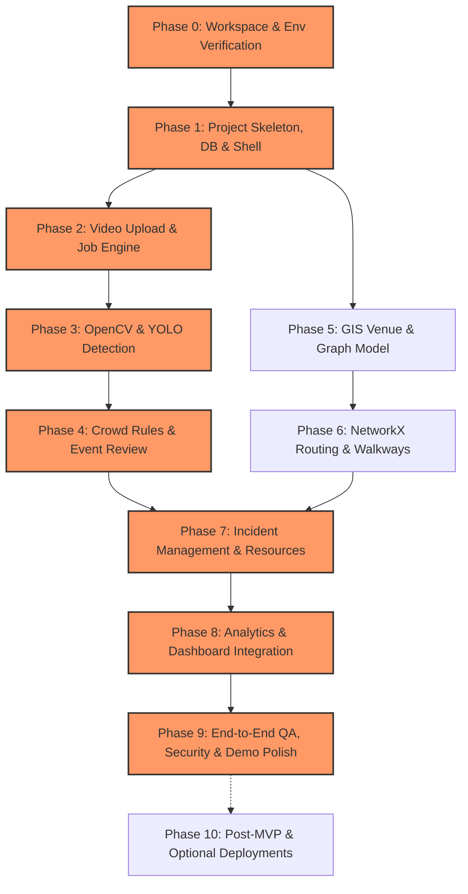

# NEXORA — Development and Implementation Roadmap

**Document ID:** DOC-015  
**Version:** 1.0  
**Status:** Draft  
**Created:** 2026-10-09  
**Last Updated:** 2026-10-09  

---

## 1. Roadmap Overview and Strategy

The NEXORA implementation strategy adheres to a disciplined, dependency-ordered engineering progression. Rather than developing isolated components, each phase delivers a verifiable increment of the central product workflow:
**Video Upload → Frame Extraction & Person Detection → Timeline & Rules → Human Event Review → GIS Venue Route Calculation & Walkway Control → Incident Creation & Simulated Resource Assignment → Audit Log & Live Operational Dashboard**.

### Guiding Principles
1. **Vertical Integrity:** Each layer connects through real Pydantic schemas, database tables, and API endpoints—avoiding mock-only facades that disconnect later.
2. **Honest Verification:** Automated tests and manual validation criteria accompany every phase. Tests are only marked passing when actually executed and verified.
3. **Graceful Degradation:** Core system capabilities remain functional even if heavy dependencies (such as external map tile servers or GPU acceleration) are unavailable.
4. **No Destructive Operations:** Workspace assets, demo footage, and seeded configuration are versioned and preserved.

---

## 2. Dependency Graph and Critical Path

### Critical Path Analysis
The primary critical path runs through **P0 → P1 → P2 → P3 → P4 → P7 → P8 → P9**.
- **Bottlenecks:** Video processing with OpenCV/YOLO (Phase 3) is the most computationally demanding step; GIS graph construction (Phase 5 & 6) can be developed in parallel once Phase 1 is established.
- **Merge Point:** Phase 7 brings the AI Event stream (Phase 4) and the Venue Spatial Network (Phase 6) together into Incidents.

---

## 3. Phase Specifications

---

### Phase 0: Workspace and Environment Verification
- **Objectives:** Validate local host prerequisites, Python/Node toolchains, hardware capabilities (CPU/GPU, RAM, disk space), and external network reachability for models and tiles.
- **Dependencies:** Operating system permissions, Python 3.10+, Node.js 18+, npm 9+.
- **Files/Modules Created:**
  - `scripts/verify_environment.py`
  - `.env.example`
  - `.gitignore`
- **Implementation Tasks:**
  1. Inspect Python virtual environment capability and PyTorch CPU/CUDA compatibility.
  2. Verify Node.js and npm versions.
  3. Verify write access to project root and `data/` directories.
  4. Test connectivity to HuggingFace / Ultralytics asset CDN and OpenStreetMap tile endpoints.
- **Acceptance Criteria:**
  - Script reports clean green status for Python >= 3.10, Node >= 18.0, and write permissions.
- **Tests to Execute:** `python scripts/verify_environment.py`
- **Definition of Done:** Environment verification script passes with zero blocking warnings.
- **Likely Risks:** Missing Visual C++ runtime on Windows for OpenCV; slow initial model download.
- **Rollback / Recovery:** Fall back to CPU PyTorch wheels (`--index-url https://download.pytorch.org/whl/cpu`).
- **Relative Effort:** Small (Critical Path)

---

### Phase 1: Project Skeleton, Database, Health Endpoint & UI Shell
- **Objectives:** Establish the monorepo workspace structure, SQLite schema migrations via SQLAlchemy/Alembic, baseline FastAPI service with CORS/logging, and React UI application shell with theme tokens.
- **Dependencies:** Phase 0.
- **Files/Modules Created:**
  - `backend/app/main.py`
  - `backend/app/core/config.py`
  - `backend/app/database.py`
  - `backend/app/models/` (Base, AuditLog, Venue)
  - `backend/app/api/v1/health.py`
  - `frontend/src/App.jsx`
  - `frontend/src/components/layout/Shell.jsx`, `Navigation.jsx`
  - `frontend/src/styles/theme.css` (implementing `DESIGN.md` dark tokens)
- **Implementation Tasks:**
  1. Scaffold `backend/` directory with clean modular layout.
  2. Implement SQLite connection with WAL mode enabled.
  3. Create initial SQLAlchemy base models and table creation routines.
  4. Scaffold `frontend/` with Vite + React + Vanilla CSS design system.
  5. Build responsive shell with Top Nav, Status Pulse, and active route switching.
- **Acceptance Criteria:**
  - `GET /api/v1/health` returns status `healthy` with database connectivity confirmation.
  - Frontend renders dark terminal theme matching `DESIGN.md` tokens without runtime errors.
- **Tests to Execute:** TC-024 (Database initialization), TC-028 (Frontend theme rendering).
- **Definition of Done:** Health check returns 200 OK and frontend navigates between placeholder views.
- **Likely Risks:** Port conflicts (8000/5173); CORS configuration mismatches.
- **Rollback / Recovery:** Bind to alternative ports (`8001`, `5174`) via `.env`.
- **Relative Effort:** Medium (Critical Path)

---

### Phase 2: Video Upload and Job Management
- **Objectives:** Provide robust file upload handling with strict MIME/magic byte validation, size ceilings, persistent job tracking in SQLite, and job status polling endpoints.
- **Dependencies:** Phase 1.
- **Files/Modules Created:**
  - `backend/app/models/video.py`, `backend/app/models/job.py`
  - `backend/app/schemas/video.py`, `backend/app/schemas/job.py`
  - `backend/app/services/video_service.py`, `backend/app/services/job_service.py`
  - `backend/app/api/v1/videos.py`, `backend/app/api/v1/jobs.py`
  - `frontend/src/views/VideoUploadView.jsx`
  - `frontend/src/components/video/Dropzone.jsx`, `JobList.jsx`
- **Implementation Tasks:**
  1. Build chunked video upload endpoint with UUID generation and sanitised storage.
  2. Validate `.mp4`, `.avi`, `.mov` file headers (reject `.exe`, `.sh`, HTML).
  3. Enforce 500 MB upload limit.
  4. Create video and processing job records with state machine (`pending`, `processing`, `completed`, `failed`).
  5. Build UI upload dropzone with real file drag-and-drop and upload progress indicator.
- **Acceptance Criteria:**
  - Valid video uploads return 201 Created with `video_id` and initial `pending` job.
  - Invalid formats and oversized files return 400/413 errors with clear user feedback.
- **Tests to Execute:** TC-001 (Valid video upload), TC-002 (Invalid file rejection), TC-003 (File size rejection).
- **Definition of Done:** End-to-end upload from React UI generates valid database record and persisted file.
- **Likely Risks:** Windows filesystem lock on open file descriptors; disk space depletion.
- **Rollback / Recovery:** Automatic cleanup of failed or abandoned upload chunks.
- **Relative Effort:** Medium (Critical Path)

---

### Phase 3: OpenCV Frame Extraction and YOLO Detection
- **Objectives:** Integrate OpenCV for video decoding and sampling interval extraction; execute Ultralytics YOLOv8n inference for person detection; store frame metadata and annotated bounding-box crops.
- **Dependencies:** Phase 2.
- **Files/Modules Created:**
  - `backend/app/models/detection.py`
  - `backend/app/schemas/detection.py`
  - `backend/app/services/visionx_engine.py`
  - `backend/app/services/frame_extractor.py`
  - `backend/app/api/v1/detections.py`
  - `frontend/src/views/DetectionTimelineView.jsx`
  - `frontend/src/components/video/DetectionTimeline.jsx`, `EvidenceViewer.jsx`
- **Implementation Tasks:**
  1. Implement frame extraction worker with configurable interval (1s to 10s, default 2s).
  2. Implement YOLOv8n worker filtering class `0` (person) above threshold (default 0.35).
  3. Generate and save annotated JPEG evidence images to `data/evidence/`.
  4. Aggregate frame timestamps, person counts, and min/max/average confidence scores into SQLite.
  5. Build React Detection Timeline view displaying counts per frame with clickable evidence inspector.
- **Acceptance Criteria:**
  - Background worker extracts frames, identifies people, saves evidence images, and marks job `completed`.
  - Detection endpoint returns structured timeline array matching API schema.
- **Tests to Execute:** TC-004 (Sampling interval), TC-005 (YOLO person count), TC-006 (Evidence generation), TC-007 (Confidence filtering).
- **Definition of Done:** Uploaded demo clip processes to completion and renders visual count timeline with evidence images.
- **Likely Risks:** High CPU usage freezing backend; OpenCV codec missing on host OS.
- **Rollback / Recovery:** Background threading with worker process pool; fallback downsampled frame resolution (640px).
- **Relative Effort:** High (Critical Path)

---

### Phase 4: Crowd Rules Engine, Event Review and Evidence Inspection
- **Objectives:** Evaluate count timelines against configurable threshold rules (`PEOPLE_THRESHOLD`, `SUSTAINED_FRAMES`); generate crowd alert events; build operator review queue with Accept/Dismiss actions.
- **Dependencies:** Phase 3.
- **Files/Modules Created:**
  - `backend/app/models/event.py`
  - `backend/app/schemas/event.py`
  - `backend/app/services/rules_engine.py`
  - `backend/app/api/v1/events.py`
  - `frontend/src/views/EventReviewQueueView.jsx`
  - `frontend/src/components/events/EventCard.jsx`, `EventDetailModal.jsx`
- **Implementation Tasks:**
  1. Build rule evaluator supporting threshold surge and sustained density rules.
  2. Create `Event` records with status `pending_review`, linked to triggering frame and camera.
  3. Implement event review endpoints: `POST /events/{id}/accept`, `POST /events/{id}/dismiss`.
  4. Build UI Event Review Queue with severity badges (Low/Medium/High/Critical) and side-by-side evidence inspection.
- **Acceptance Criteria:**
  - Videos with counts exceeding threshold generate reviewable events.
  - Operator can accept or dismiss events with mandatory reason logged to audit trail.
- **Tests to Execute:** TC-008 (Threshold surge event), TC-009 (Sustained count event), TC-010 (Event review accept/dismiss).
- **Definition of Done:** Rule engine produces events from detected frames; UI allows full human-in-the-loop triage.
- **Likely Risks:** Rule flap on borderline detection counts.
- **Rollback / Recovery:** Add hysteresis band (e.g. count must exceed threshold by 2 for sustained alert).
- **Relative Effort:** Medium (Critical Path)

---

### Phase 5: GIS Venue Configuration and Graph Network Model
- **Objectives:** Load structured JSON venue configuration into memory and SQLite; construct spatial entities (zones, cameras, gates, walkways, junctions) and render interactive Leaflet map.
- **Dependencies:** Phase 1.
- **Files/Modules Created:**
  - `backend/app/models/venue.py`
  - `backend/app/schemas/venue.py`
  - `backend/app/services/venue_service.py`
  - `backend/app/api/v1/venues.py`
  - `data/venue/demo_venue.json`
  - `frontend/src/views/VenueMapView.jsx`
  - `frontend/src/components/map/LeafletMap.jsx`, `ZoneOverlay.jsx`, `CameraMarker.jsx`
- **Implementation Tasks:**
  1. Build seed venue configuration for Grand Festival Grounds (8 zones, 12 junctions, 16 walkways, 4 exits).
  2. Implement venue loader and validation schema in FastAPI.
  3. Integrate Leaflet.js with custom dark-mode tile styling or offline SVG fallback canvas.
  4. Render interactive zone polygons, exit icons, and camera coverage markers.
- **Acceptance Criteria:**
  - `GET /api/v1/venues/{id}` returns complete topological specification.
  - Map renders demo venue with clickable zones and camera metadata popups.
- **Tests to Execute:** TC-011 (Venue configuration parsing), TC-012 (Map layer rendering).
- **Definition of Done:** Venue map interactive with accurate spatial boundaries and clean visual presentation.
- **Likely Risks:** Slow tile loading on restricted networks; Leaflet CSS asset path issues in bundler.
- **Rollback / Recovery:** Embedded vector fallback map canvas rendered via GeoJSON.
- **Relative Effort:** Medium

---

### Phase 6: NetworkX Routing Engine and Walkway Controls
- **Objectives:** Construct bidirectional weighted graph from venue data using NetworkX; calculate optimal and alternative routes using cost formula; implement walkway block/unblock with immediate rerouting.
- **Dependencies:** Phase 5.
- **Files/Modules Created:**
  - `backend/app/services/routing_engine.py`
  - `backend/app/api/v1/routes.py`
  - `backend/app/api/v1/walkways.py`
  - `frontend/src/components/map/RouteVisualizer.jsx`, `WalkwayControlPanel.jsx`
- **Implementation Tasks:**
  1. Build graph builder converting JSON nodes and edges into `networkx.DiGraph`.
  2. Implement cost formula: `Cost = (Length / BaseSpeed) * DensityMultiplier * PenaltyFactor`.
  3. Implement primary and k-shortest alternative path discovery (`dijkstra_path`, `shortest_simple_paths`).
  4. Implement `POST /walkways/{id}/block` (removes edge or sets infinite weight) and `/unblock`.
  5. Build route visualization with color-coded safety rating and blockage toggle controls.
- **Acceptance Criteria:**
  - Routing calculates shortest valid path from selected origin to target exit.
  - Blocking a walkway recalculates route dynamically; isolated zones return clear `NO_VALID_ROUTE` state.
- **Tests to Execute:** TC-013 (Route calculation), TC-014 (Alternative route generation), TC-015 (Walkway block reroute), TC-016 (No valid route isolation).
- **Definition of Done:** Operators can block walkways and observe instant visual route updates and alternative path costs.
- **Likely Risks:** Disconnected graph causing unhandled NetworkX exceptions.
- **Rollback / Recovery:** Catch `NetworkXNoPath` and return structured 200 response with `route_found: false` and advisory notice.
- **Relative Effort:** High

---

### Phase 7: Incident Management, Resource Allocation and Audit History
- **Objectives:** Create formal incident lifecycle (`reported` → `triaged` → `dispatched` → `on_scene` → `resolved`) triggered manually or from accepted events; manage simulated response resources; log all mutations to immutable audit table.
- **Dependencies:** Phase 4, Phase 6.
- **Files/Modules Created:**
  - `backend/app/models/incident.py`, `backend/app/models/resource.py`, `backend/app/models/audit.py`
  - `backend/app/schemas/incident.py`, `backend/app/schemas/resource.py`, `backend/app/schemas/audit.py`
  - `backend/app/services/incident_service.py`, `backend/app/services/audit_service.py`
  - `backend/app/api/v1/incidents.py`, `backend/app/api/v1/resources.py`, `backend/app/api/v1/audit.py`
  - `frontend/src/views/IncidentManagementView.jsx`
  - `frontend/src/components/incidents/IncidentTable.jsx`, `ResourceAssignModal.jsx`, `AuditLogViewer.jsx`
- **Implementation Tasks:**
  1. Build incident creation pipeline linking optional `event_id`, zone, severity, and description.
  2. Build resource registry (Medical Units, Security Patrols, Crowd Wardens) with status toggles (`available`, `assigned`, `offline`).
  3. Implement resource assignment to active incidents.
  4. Implement status transition endpoint with mandatory notes.
  5. Build audit interceptor writing every operator mutation (walkway toggles, event triages, incident changes) to SQLite audit log.
- **Acceptance Criteria:**
  - Incident created from accepted event retains link to original video evidence.
  - Resource assignment updates availability; audit log captures actor, action, timestamp, and details.
- **Tests to Execute:** TC-017 (Incident creation from event), TC-018 (Resource assignment), TC-019 (Incident resolution lifecycle), TC-020 (Audit trail completeness).
- **Definition of Done:** Full workflow verified from accepted crowd event to incident resolution and audit inspection.
- **Likely Risks:** Race condition in resource double-assignment in concurrent tab sessions.
- **Rollback / Recovery:** Database transaction locks with status validation before assignment.
- **Relative Effort:** High (Critical Path)

---

### Phase 8: Analytics, Reporting and Live Operational Dashboard
- **Objectives:** Assemble the master Command Centre dashboard aggregating live metrics directly from database queries (active incidents, crowd alerts, zone density status, resource readiness); render trend charts and exportable summary reports.
- **Dependencies:** Phase 7.
- **Files/Modules Created:**
  - `backend/app/services/analytics_service.py`
  - `backend/app/api/v1/dashboard.py`
  - `frontend/src/views/DashboardView.jsx`
  - `frontend/src/components/dashboard/StatCards.jsx`, `RecentAlertsFeed.jsx`, `ZoneSummaryGrid.jsx`
- **Implementation Tasks:**
  1. Implement dashboard aggregator endpoint returning calculated counts (no fake mock constants).
  2. Build top-level KPI cards with status pulse indicators.
  3. Render active zone risk breakdown and recent incident activity stream.
  4. Provide incident summary report export (JSON/CSV).
- **Acceptance Criteria:**
  - Dashboard metrics reflect real database counts and dynamically update when videos/incidents change.
  - Zero hardcoded mock numbers presented as real system state.
- **Tests to Execute:** TC-021 (Dashboard metrics aggregation), TC-022 (Data consistency between screens).
- **Definition of Done:** Executive dashboard provides real-time situational picture derived from operational data.
- **Likely Risks:** N+1 SQL queries slowing dashboard load.
- **Rollback / Recovery:** Use optimized SQLAlchemy join queries and index on foreign keys.
- **Relative Effort:** Medium (Critical Path)

---

### Phase 9: End-to-End QA, Security Review, Documentation & Demo Polish
- **Objectives:** Run complete test suite (30 test cases); perform security validation (input sanitization, path traversal tests); refine UI micro-interactions; prepare seed demonstration scenarios.
- **Dependencies:** Phase 8.
- **Files/Modules Created:**
  - `tests/test_api_endpoints.py`
  - `tests/test_visionx_pipeline.py`
  - `tests/test_routing_engine.py`
  - `tests/test_security_bounds.py`
  - `data/demo_scenarios/seed_data.py`
  - `scripts/reset_demo_state.py`
- **Implementation Tasks:**
  1. Execute unit and integration tests across backend and frontend.
  2. Verify path traversal defenses on video and evidence file download routes.
  3. Test demo walkthrough scenario from start to finish.
  4. Create one-click demo data reset script.
  5. Audit documentation for link integrity and schema alignment.
- **Acceptance Criteria:**
  - All automated test suites pass.
  - Demo scenario executes without errors in under 5 minutes.
  - Demo reset script returns database to clean baseline.
- **Tests to Execute:** TC-001 through TC-030.
- **Definition of Done:** Product is demonstrably stable, verifiable, secure, and ready for live hackathon evaluation.
- **Likely Risks:** Flaky tests or timing issues in video processing tests.
- **Rollback / Recovery:** Include lightweight mock video fixture (5-frame clip) for fast deterministic testing.
- **Relative Effort:** Medium (Critical Path)

---

### Phase 10: Optional Post-MVP Enhancements and Deployment
- **Objectives:** Optional extensions beyond core MVP scope: containerization with Docker Compose, cloud deployment blueprints, WebSockets for push notifications, and camera calibration tooling.
- **Dependencies:** Phase 9.
- **Files/Modules Created:**
  - `Dockerfile.backend`, `Dockerfile.frontend`
  - `docker-compose.yml`
  - `docs/deployment/cloud-architecture.md`
- **Implementation Tasks:**
  1. Package backend and frontend into multi-stage container builds.
  2. Configure environment profiles for staging/production.
  3. Document WebSocket architectural upgrade path for live CCTV streams.
- **Acceptance Criteria:**
  - Containers build and run cleanly on any Docker-compatible host.
- **Tests to Execute:** Container smoke test.
- **Definition of Done:** Stretch features documented and packaged without destabilizing local prototype.
- **Likely Risks:** Model weights bloating container image size.
- **Rollback / Recovery:** Mount model weights and video storage via external persistent volumes.
- **Relative Effort:** Low (Stretch / Optional)

---

## 4. Phase Summary and Effort Allocation

| Phase | Description | Critical Path? | Relative Effort | Prerequisite |
|-------|-------------|:--------------:|:---------------:|:------------:|
| **Phase 0** | Workspace & Env Verification | Yes | Small | None |
| **Phase 1** | Project Skeleton, DB & UI Shell | Yes | Medium | Phase 0 |
| **Phase 2** | Video Upload & Job Management | Yes | Medium | Phase 1 |
| **Phase 3** | OpenCV & YOLO Detection | Yes | High | Phase 2 |
| **Phase 4** | Crowd Rules & Event Review | Yes | Medium | Phase 3 |
| **Phase 5** | GIS Venue & Map Network | No (Parallel) | Medium | Phase 1 |
| **Phase 6** | NetworkX Routing & Walkways | No (Parallel) | High | Phase 5 |
| **Phase 7** | Incident Management & Audit | Yes | High | Phase 4, Phase 6 |
| **Phase 8** | Dashboard & Analytics | Yes | Medium | Phase 7 |
| **Phase 9** | End-to-End QA & Demo Prep | Yes | Medium | Phase 8 |
| **Phase 10**| Optional Deployment / Docker | No (Post-MVP) | Low | Phase 9 |

---

*End of Document 15 — Development and Implementation Roadmap*
