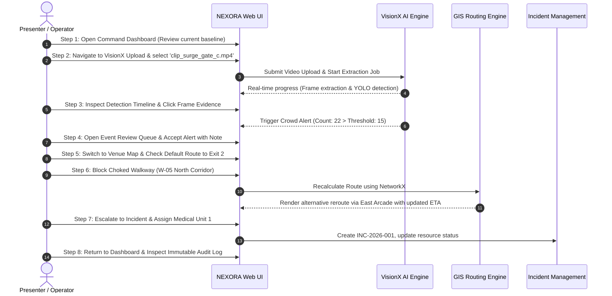

# NEXORA — Hackathon Demo and Presentation Plan

**Document ID:** DOC-017  
**Version:** 1.0  
**Status:** Draft  
**Created:** 2026-10-09  
**Last Updated:** 2026-10-09  

---

## 1. Executive Summary & Problem Statement

### The Problem
During massive religious gatherings, festivals, and transit surges (such as the Kumbh Mela, pilgrimages, and railway terminal events), crowd safety management faces a dangerous structural flaw: **information fragmentation**.
- Safety coordinators lack real-time crowd-density verification from visual footage.
- On-the-ground bottlenecks and stampede pre-conditions develop silently without objective metric alerts.
- When an emergency occurs, spatial routing is disconnected from crowd data, leading to misguided evacuations through congested corridors.
- Incident tracking relies on verbal radio calls with zero auditable evidence.

### The NEXORA Solution
**NEXORA** is an integrated web-based crowd safety intelligence and emergency response coordination platform.
It combines:
1. **VisionX:** Operator-directed AI video analysis using Ultralytics YOLO to extract accurate person counts and transparent evidence crops without facial surveillance.
2. **Dynamic GIS Routing:** A graph-based venue network powered by NetworkX that models crowd impedance, enables instant walkway blockage control, and recalculates safe evacuation routes in real time.
3. **Accountable Emergency Coordination:** A unified command centre that ties detected crowd surges to verified incidents, dispatches simulated medical/security teams, and records an unalterable audit log.

---

## 2. Key Innovation and Differentiation

| Traditional Approaches | Generic Computer Vision Demos | NEXORA Platform |
|------------------------|-------------------------------|-----------------|
| Manual headcounts & radio dispatch | Isolated object detection bounding boxes | **End-to-End Vertical Pipeline:** Video → AI Detection → Crowd Event → Human Review → Map Rerouting → Incident Dispatch → Audit Trail |
| Static evacuation plans on paper | Static dashboard mockups with fake numbers | **Dynamic Cost Routing:** Live graph recalculation incorporating density penalties and blocked choke points |
| Unverified AI "black box" decisions | Facial recognition / biometric surveillance | **Human-in-the-Loop & Privacy by Design:** Only counts heads; human operator must accept alerts; full visual evidence provided |

---

## 3. Demo Assets & Prerequisites

### 3.1 Demo Sample Videos
Two short, pre-validated video clips (10–25 seconds each, 720p H.264) reside in `data/demo_scenarios/`:
1. `clip_surge_gate_c.mp4` (~15s): Shows high crowd congestion building near Gate C / North Corridor (triggers High Density event, count > 15).
2. `clip_normal_plaza.mp4` (~10s): Shows normal, fluid pedestrian flow across Central Plaza (demonstrates low count, no alarms triggered).

### 3.2 Demo Venue Setup
**"Grand Cultural Arena — Sector 4"**
- 8 Zones (Main Stage, Central Plaza, North Food Court, East Arcade, West Promenade, Gate A, Gate B, Gate C).
- 12 Junction Nodes and 16 Directed Walkway Edges.
- 4 Monitored Camera Feeds (CAM-01 through CAM-04).
- 4 Designated Evacuation Exits (Exit 1 Main, Exit 2 North, Exit 3 East, Exit 4 West).

---

## 4. End-to-End Live Demonstration Script (5-Minute Walkthrough)



### Detailed Screen-by-Screen Transitions

#### Minute 0:00 – 0:45 | Scene 1: Dashboard Overview & The Stakes
- **Screen:** `DashboardView` (`/dashboard`)
- **Presenter Action:** Point out the dark command-centre layout, active zone readiness, and operational metrics.
- **Narrative:** *"Imagine you are coordinating safety at a festival with 50,000 attendees. This is NEXORA. Every number here is backed by live data in our database."*

#### Minute 0:45 – 2:00 | Scene 2: VisionX Video Ingestion & AI Evidence
- **Screen:** `VideoUploadView` (`/visionx/upload`) → `DetectionTimelineView` (`/visionx/timeline`)
- **Presenter Action:** Drag and drop `clip_surge_gate_c.mp4` into the upload zone. Click "Begin Analysis".
- **System Output:** Job progress bar pulses from `0%` to `100%`. Timeline renders showing frame timestamps (00:02, 00:04, 00:06...) with rising person counts.
- **Key Moment:** Click on timestamp 00:08 (Count: 22). The Evidence Viewer modal opens displaying the exact video frame with green bounding boxes around detected individuals.
- **Narrative:** *"VisionX detected a surge. Crucially, we do not use face recognition. We measure crowd density and provide transparent visual evidence to the operator."*

#### Minute 2:00 – 2:45 | Scene 3: Human-in-the-Loop Event Review
- **Screen:** `EventReviewQueueView` (`/events`)
- **Presenter Action:** Open the newly generated alert: `EVT-001: High Crowd Density at North Corridor`.
- **Presenter Action:** Review the confidence interval (avg 0.82) and thumbnail. Click **"Accept & Escalate"**. Type review note: *"Confirmed gate bottleneck on camera CAM-03."*
- **Narrative:** *"In life-safety systems, AI must never make unilateral executive decisions. NEXORA enforces human-in-the-loop triage."*

#### Minute 2:45 – 3:45 | Scene 4: Spatial GIS Rerouting & Walkway Blocking
- **Screen:** `VenueMapView` (`/venue`)
- **Presenter Action:** Select Origin `Zone 3 (North Food Court)` and Destination `Exit 2 (North Gate)`.
- **System Output:** Map renders the initial shortest route along Walkway W-05 (North Corridor) highlighted in orange (ETA: 1.8 mins).
- **Presenter Action:** In the Walkway Control Panel, click the **"Block Walkway"** toggle on W-05.
- **System Output:** Walkway W-05 instantly shifts to hatched red with a blockage barrier icon. The route line animates and snaps to the alternative corridor (W-08 East Arcade) with recalculated travel time (ETA: 3.4 mins).
- **Narrative:** *"When a corridor is blocked or dangerous, NEXORA's NetworkX routing engine eliminates that edge and computes the safest available alternative path in under 50 milliseconds."*

#### Minute 3:45 – 4:30 | Scene 5: Incident Resolution & Resource Dispatch
- **Screen:** `IncidentManagementView` (`/incidents`)
- **Presenter Action:** Create incident `INC-001: Surge Bottleneck at North Gate`. Assign `Medical Unit 1` and `Crowd Warden Team Bravo`.
- **Presenter Action:** Change incident status to `DISPATCHED`, then resolve to `RESOLVED` with final clearance notes.
- **Narrative:** *"The system bridges spatial intelligence into operational dispatch. Response teams receive verified origin, destination, and obstacle data."*

#### Minute 4:30 – 5:00 | Scene 6: Dashboard Audit & Accountability
- **Screen:** `DashboardView` (`/dashboard`) → `AuditLogModal`
- **Presenter Action:** Show the live updated KPI metrics (Incidents Resolved: 1, Active Blockages: 1).
- **Presenter Action:** Open the Audit Log table to reveal the immutable chronological record: Video Upload → AI Detection → Operator Review → Walkway Blocked → Resource Dispatched.
- **Closing Punchline:** *"NEXORA transforms passive video footage into verifiable, resilient crowd safety intelligence."*

---

## 5. Failure Recovery & Contingency Plan

| Potential Demo Glitch | Rapid Contingency Plan |
|-----------------------|------------------------|
| **Wi-Fi Drops during presentation** | All core modules run 100% locally on `localhost`. Map geometry, graph routing, YOLO detection, and SQLite run offline without internet. |
| **Model download hangs or network blocks weights** | Seed weights `yolov8n.pt` are bundled pre-cached in `data/models/`. System detects local file immediately without making network calls. |
| **Video processing takes longer than expected** | Use the pre-processed fixture `clip_surge_gate_c.mp4` where detections are already cached in database seed data. |
| **Operator makes wrong click during demo** | Click the **"Reset Demo State"** button on the bottom admin bar to restore the clean state in 2 seconds. |

---

## 6. Technical Limitations to Disclose Honestly

To maintain strict academic and professional integrity with hackathon judges, explicitly state:
1. **Prerecorded Video Scope:** NEXORA processes operator-uploaded clips rather than live RTSP CCTV camera multiplexers.
2. **CPU Inference Latency:** Running YOLO on CPU takes ~1.5x video real-time; production deployment would utilize NVIDIA TensorRT or GPU acceleration.
3. **Simulated Resources:** Response teams are simulated operational entities in the prototype database, not live GPS-tracked vehicle transponders.
4. **Advisory Decision Support:** NEXORA provides decision support for human venue coordinators; it is not a legally certified autonomous building evacuation system.

---

## 7. Anticipated Judge Questions & Evidence-Based Answers

### Q1: *"Why not analyze live CCTV video streams directly instead of uploaded files?"*
> **Answer:** *"For this hackathon prototype, recorded video ingestion allows deterministic verification, reproducible testing, and avoids the flakiness of unreliable network camera connections. Our backend architecture separates frame ingestion from the detection engine, meaning swapping OpenCV file reading with an RTSP video stream is an architectural extension, not a rewrite."*

### Q2: *"How do you prevent false positives from causing stampedes or unnecessary panic?"*
> **Answer:** *"By design, NEXORA never broadcasts alerts directly to the public. It is a decision-support tool for trained venue controllers. Furthermore, every alert requires human operator confirmation and is backed by visual evidence bounding-box crops, confidence ratings, and sustained-count rules."*

### Q3: *"What happens if all exits from a zone are blocked?"*
> **Answer:** *"Our NetworkX routing engine explicitly detects graph disconnection. If no path exists, instead of failing silently or crashing, it returns a structured `NO_VALID_ROUTE` warning, alerting controllers that a zone is physically isolated and requires immediate emergency cordon intervention."*

### Q4: *"Why do you use NetworkX instead of Google Maps or Mapbox Directions API?"*
> **Answer:** *"Public mapping APIs only map public roads and know nothing about internal festival grounds, temporary pilgrimage barricades, tent rows, or emergency access gates. Our custom venue graph allows venue planners to define internal walkways and dynamically set costs or block paths in milliseconds."*

---

## 8. Demo Data Reset Script

The system includes a dedicated one-command reset script to ensure repeat demonstrations start from a clean baseline:

```powershell
python scripts/reset_demo_state.py
```
This script wipes temporary uploads and test incidents, resets simulated teams to `available`, and restores the initial clean venue map.

---

*End of Document 17 — Hackathon Demo and Presentation Plan*
