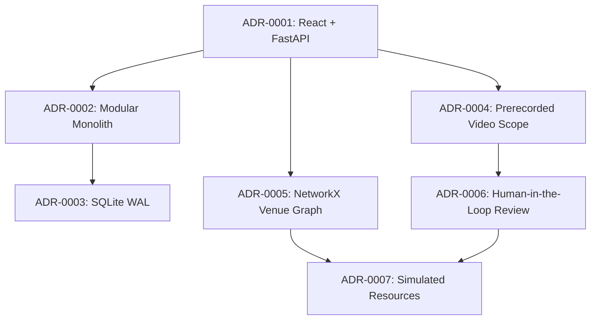

# NEXORA — Architecture Decision Records (ADRs)

**Document ID:** DOC-018  
**Version:** 1.0  
**Status:** Approved  
**Created:** 2026-10-09  
**Last Updated:** 2026-10-09  

---

## 1. Overview of Architecture Decision Records

Architecture Decision Records (ADRs) capture critical software architecture decisions along with their context, evaluated alternatives, rationale, and consequences. These records preserve architectural memory and ensure engineering alignment across all development phases.

Individual ADR files are maintained in the [`docs/adr/`](file:///c:/Users/ssure/OneDrive/Documents/nexora%21/docs/adr) directory.

---

## 2. ADR Register and Summary

| ADR ID | Decision Title | Status | Date | Summary |
|--------|---------------|:------:|:----:|---------|
| [**ADR-0001**](file:///c:/Users/ssure/OneDrive/Documents/nexora%21/docs/adr/0001-react-and-fastapi.md) | Selection of React and FastAPI Stack | Accepted | 2026-10-09 | Selects FastAPI for native Python AI/CV/NetworkX integration and React 18 + Vite for high-performance responsive UI rendering. |
| [**ADR-0002**](file:///c:/Users/ssure/OneDrive/Documents/nexora%21/docs/adr/0002-modular-monolith.md) | Modular Monolith Architecture for Backend | Accepted | 2026-10-09 | Adopts a modular monolith over distributed microservices to avoid network serialization overhead for video frames and simplify hackathon deployment. |
| [**ADR-0003**](file:///c:/Users/ssure/OneDrive/Documents/nexora%21/docs/adr/0003-sqlite-for-local-prototype.md) | SQLite with WAL for Prototype Persistence | Accepted | 2026-10-09 | Employs SQLite in WAL mode via SQLAlchemy 2.0 for zero-dependency local operation, instant demo backups, and robust relational integrity. |
| [**ADR-0004**](file:///c:/Users/ssure/OneDrive/Documents/nexora%21/docs/adr/0004-prerecorded-video-analysis-scope.md) | Prerecorded Video Analysis Initial Scope | Accepted | 2026-10-09 | Focuses MVP scope on operator-uploaded recorded video footage to ensure deterministic testing, consumer CPU feasibility, and demo reliability. |
| [**ADR-0005**](file:///c:/Users/ssure/OneDrive/Documents/nexora%21/docs/adr/0005-explicit-venue-routing-graph.md) | Explicit Venue Routing Graph with NetworkX | Accepted | 2026-10-09 | Implements internal venue pathfinding using NetworkX and JSON geometry, enabling instant blockage handling and crowd cost weighting independent of external map APIs. |
| [**ADR-0006**](file:///c:/Users/ssure/OneDrive/Documents/nexora%21/docs/adr/0006-human-in-the-loop-alert-review.md) | Mandatory Human-in-the-Loop Alert Review | Accepted | 2026-10-09 | Mandates operator triage (Accept/Dismiss) for AI crowd alerts before incident escalation, preventing automated false-alarm panic and upholding ethical AI guidelines. |
| [**ADR-0007**](file:///c:/Users/ssure/OneDrive/Documents/nexora%21/docs/adr/0007-simulated-resource-assignment.md) | Simulated Entities for Resource Assignment | Accepted | 2026-10-09 | Models emergency responders as stateful simulated database entities rather than attempting unfeasible real CAD dispatch integration, preserving honesty. |

---

## 3. Decision Inter-Dependencies

---

*End of Document 18 — Architecture Decision Records*
